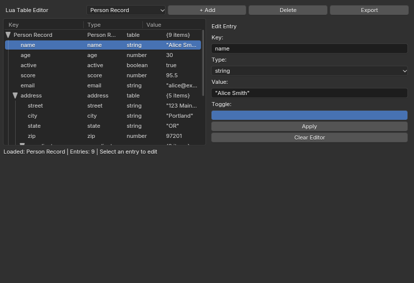

# BUI Lua Host — `bui-lua`

A standalone executable that embeds Lua 5.4 and exposes BUI's full retained-mode
UI toolkit as a native Lua module. Cross-platform (macOS, Linux, Windows).

## Build

```sh
cmake -S . -B build -DBUI_BUILD_LUA_BINDINGS=ON
cmake --build build --target bui-lua
```

The binary is `build/bindings/lua/bui-lua`.

## Usage

```sh
bui-lua app.lua          # run a Lua script (blocks on bui.run())
bui-lua                  # interactive REPL prompt
bui-lua -e "code"        # inline evaluation
bui-lua --headless t.lua # run without a display
bui-lua --version        # print version
```

## Module API

```lua
local bui = require("bui")
```

### Factories

| Function | Returns | Description |
|----------|---------|-------------|
| `bui.Node(type)` | node | Create a UI node (`"button"`, `"slider"`, `"frame"`, `"tree"`, etc.) |
| `bui.Context(root_node)` | ctx | Create an input context for a node tree |
| `bui.Window(ctx, title, w, h)` | win | Create a native window, or nil on headless |
| `bui.TreeItem(label, icon)` | item | Create a tree item (for `"tree"` nodes) |

### Node Methods

| Method | Description |
|--------|-------------|
| `node:add(child [, index])` | Add a child node |
| `node:remove(child)` | Detach a child |
| `node:child(i)` | Get child by index |
| `node:children()` | Get all children as a table |
| `node:parent()` | Get parent node |
| `node:type()` | Get node type string |
| `node:rect()` | Get `x, y, w, h` |
| `node:set(key, value)` | Set property (auto-dispatch string/number/bool/table) |
| `node:get(key)` | Get property (number or string) |
| `node:on(event, callback)` | Attach event handler (`callback(self, a, b)`) |
| `node:off(event)` | Detach event handler |
| `node:geom(manager, opts)` | Set geometry manager + options (pack/grid/place) |
| `node:invalidate()` | Mark for redraw |
| `node:relayout()` | Mark for relayout |
| `node:free()` | Free the C node |

### Context Methods

| Method | Description |
|--------|-------------|
| `ctx:render(w, h [, full])` | Render to raster, returns `pixels, regions, w, h` |
| `ctx:press(x, y [, mods])` | Forward mouse press |
| `ctx:release(x, y [, mods])` | Forward mouse release |
| `ctx:motion(x, y [, mods])` | Forward mouse motion |
| `ctx:key(text, keysym [, mods])` | Forward key press |
| `ctx:wheel(x, y, delta [, mods])` | Forward mouse wheel |
| `ctx:bind(combo, fn)` | Bind keyboard shortcut |

### Window Methods

| Method | Description |
|--------|-------------|
| `win:show()` | Show the window |
| `win:close()` | Close the window |
| `win:is_open()` | Check if window is open |
| `win:set_title(t)` | Set window title |
| `win:set_size(w, h)` | Set window size |
| `win:get_size()` | Get `w, h` |
| `win:render_now()` | Force immediate render |

### Constants

| Group | Example Values |
|-------|---------------|
| Events | `bui.EV_CLICK`, `bui.EV_CHANGE`, `bui.EV_CALL`, `bui.EV_KEY`, `bui.EV_WHEEL` |
| Cursors | `bui.CURSOR_DEFAULT`, `bui.CURSOR_HAND`, `bui.CURSOR_TEXT` |
| Geometry | `bui.GEOM_PACK`, `bui.GEOM_GRID`, `bui.GEOM_PLACE` |
| Modifiers | `bui.MOD_SHIFT`, `bui.MOD_CTRL`, `bui.MOD_ALT` |
| Widgets | `bui.WIDGET_BUTTON`, `bui.WIDGET_SLIDER`, `bui.WIDGET_LABEL` |

## Sample: Lua Table Editor

The `lua_table_editor.lua` example is a complete interactive table editor that
demonstrates the full BUI tree widget API.



The editor features:
- **3-column tree view** (Key / Type / Value) using BUI's `tree` node
- **3 demo tables**: Person Record (mixed types), Project Config (deep nesting),
  Game State (arrays + empty tables)
- **Side panel editor**: click any row to edit its key, type, and value
- **Type-aware editing**: string/number text fields, boolean toggle
- **Add / Delete / Apply** row operations
- **Export**: serializes the table back to Lua source

```lua
bui-lua bindings/lua/examples/lua_table_editor.lua
```

## Additional Examples

| File | Description |
|------|-------------|
| `examples/hello.lua` | Minimal button with click handler |
| `examples/counter.lua` | Increment/decrement/reset counter |
| `examples/todos.lua` | Todo list with text input |
| `examples/gallery.lua` | Widget gallery across multiple categories |
| `examples/lua_table_editor.lua` | Interactive Lua table editor |

## Project Structure

```
bindings/lua/
├── CMakeLists.txt          # Build system (bundles Lua 5.4.7 + linenoise)
├── README.md               # Quick-start documentation
├── images/                 # Screenshots for docs
├── lua-5.4.7/              # Vendored Lua 5.4 source (32 .c files)
├── extern/linenoise/       # Vendored linenoise (MIT)
├── src/
│   ├── main.c              # CLI, REPL, script runner
│   ├── bui_lua.c           # Module init, 80+ constants, factories
│   ├── bui_node.c          # BKNode + BKTreeItem userdata (~40 methods)
│   ├── bui_context.c       # BKContext + BKHost callback bridge
│   ├── bui_window.c        # BKWindow userdata (~17 methods)
│   ├── bui_image.c         # BKImBuf / BKVideo wrappers
│   └── bui_internal.h      # Shared types and macros
└── examples/               # Example Lua scripts
```

## Implementation Details

- **Event dispatch**: C's `BKHost.emit` walks a weak-keyed node map to find the
  Lua userdata for each `BKNode*`, then calls the registered Lua callback from
  the node's uservalue table.
- **Memory model**: C nodes are owned by the tree (parent). Lua userdata wrappers
  are thin handles — `__gc` does not free the C node. The context frees the
  entire tree on cleanup.
- **BKHost callbacks**: `request`, `set_cursor`, `clipboard_get/set`, `schedule`,
  and `emit` are all bridged to Lua callbacks through the `BKContext` wrapper.
- **Property dispatch**: `node:set(key, value)` auto-detects the type
  (string/number/boolean/table) and calls the appropriate `BK_set_*` function.
- **Constants**: All 80+ BUI enums (`BK_EV_*`, `BK_CURSOR_*`, `BK_WIDGET_*`,
  etc.) are registered with clean short names (`EV_CLICK`, `CURSOR_HAND`, etc.).
