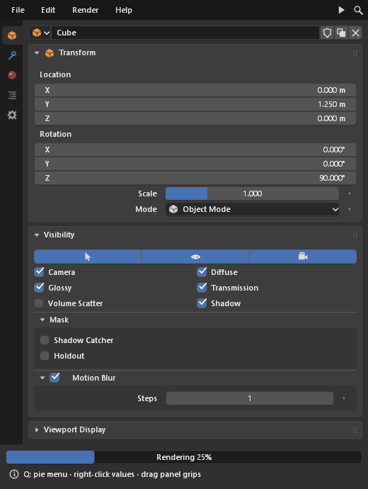
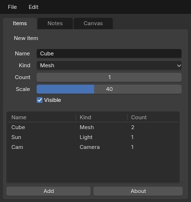
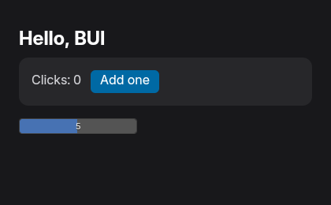
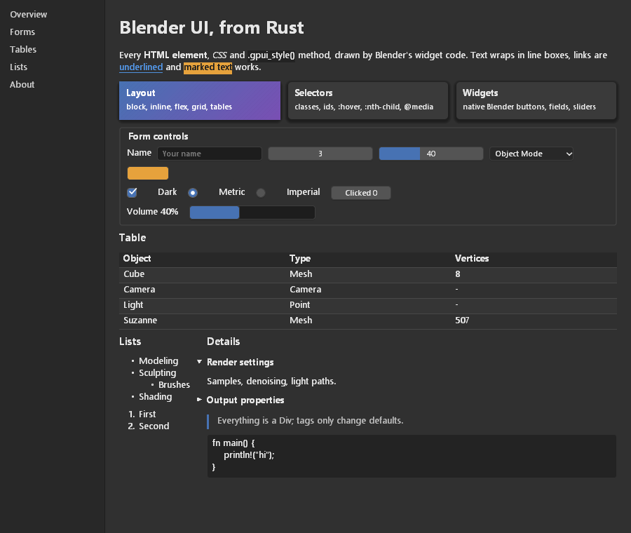
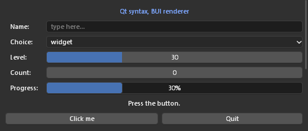
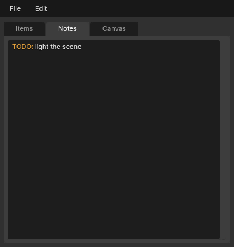
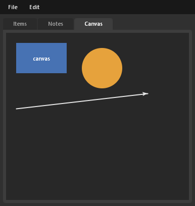
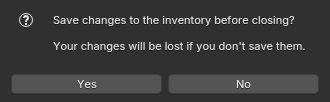

<div align="center">

# BUI

**Blender's user interface, as a library you can use from Python, Rust, JS/React and C.**

Scrubbable number fields, drag-toggles, pie menus, the color wheel and Ctrl+Z on every edit:
the real Blender widgets, driven by the tkinter or Qt code you already know, by HTML + CSS + Tailwind in Rust, or by plain C.

[](https://pypi.org/project/blenderui/)
[](https://pypi.org/project/blenderui/)
[](https://github.com/ppmpreetham/BUI/actions/workflows/wheels.yml)
[](#license)


[Quick start](#quick-start) ·
[What it can do](#what-it-can-do) ·
[Platforms](#platforms) ·
[Status](#status-whats-done-and-whats-not) ·
[Docs](#documentation) ·
[Performance](#performance) ·
[Benchmarks](#run-the-benchmarks-yourself) ·
[Contributing](#contributing)




<sub>Left: the component library. Right: an unmodified tkinter program, now looking like Blender.</sub>

</div>

> [!NOTE]
> This repository is built entirely using LLMs. No human-written code.

## What is BUI?

BUI takes the user interface of [Blender](https://www.blender.org) (its widget
drawing, its interaction rules and its look) and turns it into a standalone
UI library with a small C core. Your code builds the widget tree and handles
callbacks. Layout, input, drawing and presenting all happen in fast native
code.

You can drive it five ways, and all of them share the same C runtime:

| You write                                                                 | You get                                                                                                        | Status           |
| ------------------------------------------------------------------------- | -------------------------------------------------------------------------------------------------------------- | ---------------- |
| **tkinter** code, even existing programs, unchanged                       | Blender-styled apps; every tkinter and ttk API                                                                 | ✅ Complete      |
| **Qt-style** Python (`QWidget`, layouts, `clicked.connect`)               | The common subset of Qt widgets                                                                                | 🟡 Partial       |
| **Blender components** in Python (`Panel`, `NumberSlider`, `PieMenu` ...) | 45 native Blender widgets and editors                                                                          | ✅ Complete      |
| **Rust**: HTML + CSS + Tailwind, JSX (`rsx!`), hooks, or gpui syntax      | A web-like framework: HTML that looks like a browser's, Blender's look with `styled`, and Blender components (`<NumberSlider>`, `<Button>` ...) | ✅ Working       |
| **JavaScript / React** on Node.js or Bun: a DOM-like API or JSX           | The same engine and components in native windows, over napi-rs; React's hooks backed by signals ([guide](docs/javascript.md)) | ✅ Working       |

### HTML, Blender, or both

In Rust and JavaScript you pick the look per element:

| You write                                                            | You get                                                                                   |
| -------------------------------------------------------------------- | ----------------------------------------------------------------------------------------- |
| Plain HTML: `<button>`, `<input type="range">`, `<select>` ...      | Exactly what a browser draws: black serif text on white, Chrome's form controls           |
| `styled` on any element: `<div styled>`, `div().styled()`            | Blender's look for it and everything inside: dark theme, UI font, Blender widgets         |
| **Blender components** (capitalized): `<NumberSlider>`, `<Button>` ... | Blender's widgets and interaction everywhere (drag to scrub, Ctrl+Z, Blender's color picker) |

The components are `Button`, `Checkbox`, `Radio`, `NumberField`, `NumberSlider`,
`TextField`, `TextArea`, `ColorSwatch`, `Dropdown` and `ProgressBar`. Each one
is the HTML element it stands for, so every attribute, style and event works on
it:

```rust
rsx! {
    <main class="p-4 flex gap-2">                          // browser look
        <input type="range" />                             // Chrome's slider
        <NumberSlider min={0.0} max={10.0} value="2.5" />  // Blender's slider
        <div styled><button>"Apply"</button></div>         // Blender's look inside
    </main>
}
div().child(Checkbox().checked(true)).child(Button().child("Apply"))   // gpui syntax
```

```jsx
import { render, NumberSlider, Button } from "@blender-ui/react"
// <NumberSlider min={0} max={10} onChange={...} />, <Button onClick={...}>Apply</Button>
// DOM API: win.createElement("NumberSlider")
```

`cargo run --example forms` shows all three side by side. Python's
[Blender components](docs/components.md) (`Panel`, `PieMenu`, the node editor
...) are a separate, larger set.

## Quick start

### Python

```sh
pip install blenderui
```

Run any tkinter program on BUI **without changing a line**:

```sh
blenderui-tk my_app.py          # same as: python -m bui.tksyntax my_app.py
```

Or opt in from code:

```python
import blenderui.tksyntax as tk
from blenderui.tksyntax import ttk, messagebox

root = tk.Tk()
name = tk.StringVar(value="Cube")
ttk.Entry(root, textvariable=name).pack(fill="x", padx=8, pady=8)
ttk.Button(root, text="Greet",
           command=lambda: messagebox.showinfo("Hi", "Hello " + name.get())).pack()
root.mainloop()
```

Or build with Blender's own components:

```python
from blenderui.components import App, Panel, NumberSlider, VectorField, Checkbox, ColorSwatch, Button

App("Object", (420, 520),
    Panel("Transform",
          VectorField("Location", (0.0, 1.25, 0.0)),
          NumberSlider("Scale", 1.0, min=0, max=10, on_change=print)),
    Panel("Shading",
          Checkbox("Shadows", True),
          ColorSwatch("Color", (0.8, 0.3, 0.1, 1.0))),
    Button("Apply", on_click=lambda: print("apply")),
).run()
```

### JavaScript and React

[](https://www.npmjs.com/package/@blender-ui/react)
[](https://www.npmjs.com/package/@blender-ui/native)

```sh
npm install @blender-ui/react react     # or: bun add @blender-ui/react react
```

```jsx
/** @jsxImportSource @blender-ui/react */
import { render, useState, NumberSlider } from "@blender-ui/react"

function Counter() {
  const [count, setCount] = useState(0) // React's hook, holding a signal
  return (
    <main styled className="p-6 flex flex-col gap-3">  {/* `styled`: Blender's look */}
      <span>Clicks: {count}</span>
      <button onClick={() => setCount((c) => c + 1)}>Add one</button>
      <NumberSlider min={0} max={10} />             {/* a Blender component */}
    </main>
  )
}

render(<Counter />, { title: "Counter", width: 360, height: 200, gpu: true })
```

```sh
bun app.jsx                    # run it (Bun reads JSX directly)
npx bui build app.jsx          # or ship it: app.exe, one 5 MB file
```

- **React 19.3, natively.** Host components are HTML elements, styled with
  CSS and Tailwind classes, with events, Suspense, transitions and actions.
  Blender's widgets are components too: `<NumberSlider>`, `<Button>`,
  `<Dropdown>` ...
  BUI draws them, on the CPU or the GPU; there's no browser and no webview.
- **React's hooks, by React's names.** `useState`, `useMemo`, `useEffect` ...
  hold signals. Pass one into JSX (`{count}`) and a change updates that one
  node without re-rendering the component. Read it while rendering
  (`count.value`) and the component re-renders, as with React.
- **One small executable.** `bui build` bundles the app onto `bui-runtime`,
  which is BUI with an embedded QuickJS engine. The result starts in under
  70 ms and needs nothing installed. `--bun` builds a Bun executable instead,
  with Node's APIs.
- **No React?** [`@blender-ui/native`](https://www.npmjs.com/package/@blender-ui/native)
  is a DOM-like API (`createElement`, `appendChild`, `addEventListener`) with
  the same signals.

Node.js 18+ or Bun. Prebuilt for Windows x64; on Linux, build the addon from
source (`npm run build` in `bindings/node`) and windows are native. Guide:
[docs/javascript.md](docs/javascript.md).

### Rust

```bash
cargo add blenderui
```

```rust
use blenderui::prelude::*;

#[component]
fn counter(label: &str) {
    let (count, set_count) = use_state(0);
    rsx! {
        <div flex items-center gap-3 p-4 rounded-xl bg-zinc-800>
            <span text-zinc-300>{label.to_string()} ": " {count().to_string()}</span>
            <div px-3 py-1 rounded-md bg-sky-700 hover:bg-sky-500 onClick={move || set_count(count() + 1)}>
                "Add one"
            </div>
        </div>
    }
}

struct Hello;

impl Render for Hello {
    fn render(&mut self, _: &mut Window, _: &mut Context<Self>) -> impl IntoElement {
        rsx! {
            <body m-0 p-6 min-h-screen flex flex-col gap-4 bg-zinc-900 text-white>
                <h1 text-2xl font-bold>"Hello, BUI"</h1>
                <counter label="Clicks" />
                <input type="range" min={0.0} max={10.0} />   // a real Blender slider
            </body>
        }
    }
}

fn main() {
    Application::new().run(|cx| {
        cx.open_window(WindowOptions::default(), |_, cx| cx.new(|_| Hello)).unwrap();
    });
}
```

<p align="center">
  
</p>

This example lives at [`bindings/rust/blenderui/examples/hello.rs`](bindings/rust/blenderui/examples/hello.rs)
(`cargo run --release --example hello`).

### C

```c
#include "BUI_kit.h"   /* see examples/kit_hello.c and docs/c-api.md */
```

Build from source with CMake (see [Building from source](#building-from-source)).

## What it can do

<table>
<tr><td width="50%" valign="top">

### 🎛️ Blender's widgets and interactions

- Number fields you **drag with a hidden, continuous cursor**: Shift for precision, Ctrl to snap.
- Ctrl+Wheel steps values, Ctrl+C / Ctrl+V copy values, Backspace resets.
- **Drag across checkboxes** to set them all.
- Press-drag-release menus, **type to search** in menus, pie menus.
- **Ctrl+Z / Ctrl+Shift+Z** on every UI edit, Tab between fields.
- Multi-field vertical drags, animated collapsing panels.
- The HSV color wheel, color ramps, curves, trees, lists, text areas and canvases.

</td><td width="50%" valign="top">

### 🐍 Python, three ways

- **tkinter**: all 7,846 public names of tkinter and ttk. Nine real programs behave identically on the standard library and on BUI.
- **Qt syntax**: widgets, layouts, signals, `QPainter`, menus and timers.
- **Components**: 45 Blender widgets, editors and templates.
- One `pip install`, no Qt or Tk widgets drawing anything.

</td></tr>
<tr><td valign="top">

### 🦀 Rust: the web platform, natively

- **All 113 HTML elements**, drawn like a browser draws them; `styled` gives any subtree Blender's look, and **Blender components** (`<NumberSlider>`, `<Button>`, `<ColorSwatch>` ...) are real Blender widgets.
- **Modern CSS**: flexbox, grid with named areas, `calc()` and every math function, `var()`, `oklch()` and `color-mix()`, `:has()`, nesting, `@layer`, `@media` ranges, `::before`/`::after`.
- **Tailwind CSS v4**: `class="md:hover:bg-sky-500/50"` or bare attributes (`<div p-4 bg-[#4772b3]>`), with **"did you mean" compile errors**.
- **`rsx!` / `view!`** JSX, **`#[component]`**, and **hooks** in zopra, React or Leptos style (`use_state`, `signal`, `Memo`, `Effect`, context).
- **gpui-compatible syntax** too: `div().flex().gap_2()`, `Render`, `cx.listener`.

</td><td valign="top">

### ⚡ Fast by design

- **Damage rendering**: an idle UI costs 0% CPU, and a hover redraws only the widget it touches.
- **Opt-in GPU renderer** (Direct3D 11 on Windows, OpenGL 3.3 on Linux), modeled on Blender's instanced widget drawing. It draws the same pixels as the CPU raster.
- In the benchmark, **2–4× less CPU per frame than gpui-fast**, with **less RAM** and a **~5 ms first frame**.
- **Blender's text**: Inter (Blender's UI font) is embedded, so text looks the same on every platform. On the GPU, glyphs are drawn from their outlines with [Slug](https://github.com/EricLengyel/Slug), falling back to a per-glyph atlas like Blender's.

</td></tr>
<tr><td valign="top">

### ⚛️ JavaScript and React

- **React 19.3** renders to BUI: HTML host components, CSS and Tailwind, events, Suspense, transitions, actions, and Blender components (`<NumberSlider>`, `<Button>` ...).
- **React's hooks, by React's names**, holding signals: a change updates one node without re-rendering. A conformance suite checks each against React's own.
- **`@blender-ui/native`**: a DOM-like API with signals, for apps without React.
- **Node.js and Bun**, through a napi-rs addon, with headless mode for tests.

</td><td valign="top">

### 📦 Small standalone apps

- **`bui build app.jsx`** produces one executable of about **5 MB**: BUI with an embedded QuickJS engine.
- **First frame in ~70 ms**, at **19 MB** of RAM, with nothing to install. There's no browser and no webview.
- **`--bun`** builds a Bun executable instead, with Node's APIs and a JIT.
- Builds take under a second: the app's bundle is appended to a prebuilt runtime.

</td></tr>
</table>

<details>
<summary><b>More screenshots</b></summary>
<p align="center">
  
  <br><sub><code>examples/showcase.rs</code>: HTML + CSS in Rust</sub><br><br>
  
  <br><sub>Qt syntax</sub><br><br>
  
  
  
  <br><sub>tkinter programs: text with tags, canvas, dialogs</sub>
</p>
</details>

### A taste of the Rust side

```rust
rsx! {
    // Tailwind as attributes, any variant, arbitrary values; typos fail to compile
    <button px-3 py-1 rounded-md bg-zinc-800 hover:bg-sky-600 md:dark:hover:bg-sky-400
            active:style="transform: scale(0.97)" onClick={move || save()}>
        "Save"
    </button>

    // control flow right in the markup
    <ul>{for item in items { <li class="py-1">{item}</li> }}</ul>
    {if dirty { <p text-amber-400>"Unsaved changes"</p> }}

    // real CSS, evaluated by the engine
    <div style="width: calc(100% - 2 * var(--gap)); background: color-mix(in oklch, var(--brand) 60%, white)" />
}
```

```text
error: rsx!: `bg-sky-50O` is not a Tailwind utility; did you mean `bg-sky-500` or `bg-sky-50` or `bg-sky-100`?
```

## Platforms

|                       | Windows                       | Linux                                              | macOS                                         |
| --------------------- | ----------------------------- | -------------------------------------------------- | --------------------------------------------- |
| Window                | Native (Win32)                | Native (X11; Wayland through XWayland)             | Native (Cocoa) 🧪                             |
| Python (`pip install`) | ✅ wheels                     | ✅ wheels                                           | ✅ wheels                                      |
| Rust                  | ✅                             | ✅ (build from source)                              | ✅ 🧪                                          |
| JavaScript / React    | ✅ prebuilt on npm             | ✅ build the addon from source (`npm run build`)    | headless (see below)                          |
| C                     | ✅                             | ✅                                                  | ✅ 🧪                                          |
| Renderer              | CPU raster, or GPU (Direct3D 11) | CPU raster, or GPU (OpenGL 3.3)                 | CPU raster                                    |
| HiDPI                 | Per-monitor DPI               | `Xft.dpi`                                          | Retina (backing scale)                        |

🧪 The macOS window host is new: it's a port of Blender's Cocoa code (GHOST),
written but not yet run on a Mac. Python can still use the stdlib Tk window
there (`BUI_HOST=tk`). Node runs BUI on its own UI thread and macOS only allows
windows on the main thread, so JavaScript stays headless on macOS for now.

On Linux, libX11 and libGL are loaded when the first window opens, so BUI
also imports and renders headless on servers and in containers without them,
and falls back to the CPU raster where OpenGL is missing. Building from source
needs the X11 headers (`libx11-dev` / `libX11-devel`); no GL headers are
needed. The C, Python, window and GPU parity tests pass on Linux, on Mesa's
software OpenGL and on an NVIDIA GPU.

## Status: what's done and what's not

### ✅ Done

| Area               | What works                                                                                                                                                                                                                                                                                                                                                                                                                                                                                                     |
| ------------------ | -------------------------------------------------------------------------------------------------------------------------------------------------------------------------------------------------------------------------------------------------------------------------------------------------------------------------------------------------------------------------------------------------------------------------------------------------------------------------------------------------------------- |
| C runtime (`kit/`) | Nodes, Tk-style geometry managers, input, Blender widget drawing, damage rendering, undo, animation, text area, canvas, scroll views                                                                                                                                                                                                                                                                                                                                                                           |
| Native windows     | Windows (Win32) and Linux (X11; Wayland through XWayland), in C: DPI-aware, frame-paced animation, clipboard, cursors, window-manager features                                                                                                                                                                                                                                                                                                                                                                    |
| tkinter syntax     | **Complete**: every public tkinter and ttk name (7,846 of 7,846)                                                                                                                                                                                                                                                                                                                                                                                                                                               |
| Components         | 45 Blender components, including the color ramp and curve editors                                                                                                                                                                                                                                                                                                                                                                                                                                              |
| Rust               | HTML (113/113 elements), Flexbox 12/12, Grid 23/23, CSS 2.1 90/90, math functions, `var()`, CSS Color 4/5, Selectors 4, `@layer`/`@media`/`@supports`/`@scope`/`@container`/`@font-face`/`@property`, `@keyframes` animations and transitions, background images, `object-fit`, Tailwind v4, `rsx!`, `#[component]` with optional props and `key`, hooks, Blender components, browser-look form controls, filters / blend modes / masks / 2D transforms, headless testing                                                                                                                                                                              |
| Rendering          | Software raster (parallel, damage-tracked), GPU renderer (Direct3D 11 on Windows, OpenGL 3.3 on Linux), portable text engine                                                                                                                                                                                                                                                                                                                                                                                                                   |
| JavaScript / React | `@blender-ui/native`: a DOM-like API over napi-rs, with its own UI thread, only changes crossing the boundary, vsync-paced `requestAnimationFrame` and signals. `@blender-ui/react`: a React 19.3 renderer whose hooks (`useState`, `useMemo`, `useEffect` ...) hold signals that update nodes without re-renders. Both on Node.js and Bun, with headless testing. `bui build` makes standalone executables: about 5 MB with the embedded QuickJS runtime, or Bun's with `--bun` ([guide](docs/javascript.md)) |
| Packaging          | [`blenderui` on PyPI](https://pypi.org/project/blenderui/), with a CI workflow for wheels on all platforms; [`@blender-ui/react`](https://www.npmjs.com/package/@blender-ui/react) and [`@blender-ui/native`](https://www.npmjs.com/package/@blender-ui/native) on npm                                                                                                                                                                                                                                                                                                                                                                                                     |

### 🟡 Partial or in progress

| Area                                                   | What's missing                                                                                                                                                                                                                                                                       |
| ------------------------------------------------------ | ------------------------------------------------------------------------------------------------------------------------------------------------------------------------------------------------------------------------------------------------------------------------------------ |
| Qt syntax (~25%)                                       | Model/view classes, docks, toolbars, splitters, Qt stylesheets ([details](docs/qt.md#coverage))                                                                                                                                                                                      |
| CSS (261 of 745 W3C properties render, 129 more parse) | 3D transforms, OpenType font features, multi-column layout. Most of the remaining W3C list is drafts, speech, print and SVG ([breakdown](docs/rust.md#coverage)) |
| Text                                                   | No text wrapping around floats; right-to-left text is reordered (bidi) but not shaped (Arabic joining), and no OpenType features                                                                                                                                                    |
| Rust components                                        | No async resources (`use_resource`); no generic components                                                                                                                                                                                                                           |
| JavaScript / React packages                            | npm packages are prebuilt for Windows x64 only (on Linux, build the addon from source); events reach JavaScript after BUI handled them (no native `preventDefault`), and `event.target` is the deepest _listening_ element |
| macOS                                                  | The native Cocoa window host is written but not yet tested on a Mac; JavaScript is headless there (Node's UI thread isn't the main thread); no GPU renderer yet |
| crates.io                                              | The crates are ready to publish but not published yet; use the git dependency for now                                                                                                                                                                                                |

### 🗺️ Planned

| Target                           | Plan                                                                                                                                        |
| -------------------------------- | ------------------------------------------------------------------------------------------------------------------------------------------- |
| **WebAssembly**                  | The kit in the browser: the raster blits to `<canvas>`, DOM events feed the kit; `@blender-ui/react` and the DOM-like API on top, unchanged |
| **egui**                         | BUI panels inside egui, plus a Blender-styled theme                                                                                         |
| **macOS GPU and JavaScript windows** | The GPU renderer on Metal (or the OpenGL backend), and Node windows on the main thread                                                  |
| **More GPU backends**            | Vulkan / WebGPU drawing the same instance stream as Direct3D 11 and OpenGL                                                                  |
| **More languages**               | C#, Go, Zig, Swift, Kotlin and Lua over the same C header; Dear ImGui; Godot, Unity and Bevy; Flutter                                       |

## How it works

```
 your code:   tkinter syntax   Qt syntax   components        Rust: rsx! / HTML / CSS / Tailwind / hooks
                     │              │            │                     │
                     └──── Python: options, signals, callbacks         └── style cascade + taffy layout
                                         │                                       │
 C kit (kit/):   node tree · geometry · input & interaction · Blender widget drawing · undo · animation
                                         │
 renderer:       damage-driven software raster (parallel)   or   GPU (Direct3D 11 / OpenGL 3.3, instanced, opt-in)
                                         │
 window:         native Win32 / X11 / Cocoa window   ·   stdlib Tk window   ·   headless (tests, screenshots)
```

- **Blender's real UI code.** Widget drawing is a C port of Blender's
  `interface_widgets.cc` (`round_box_edges`, `widgetbase_draw`, the shape
  tables). Color math, rects and text cursors are Blender's `blenlib`.
- **One node tree.** Every widget is one kit node. The C kit owns layout, hit
  testing, hover, focus, drags, menus, tooltips, undo and animation.
- **Damage rendering.** A change marks only its widget's rectangle, and only
  changed tiles reach the screen.
- **Thin bindings.** Python and Rust keep only what the syntax layer needs.

More: [ARCHITECTURE.md](ARCHITECTURE.md).

## Performance

### Start time and battery

The same small settings window (a label, text field, checkbox, slider and
button) written each of the five ways, from [`bench/apps`](bench/apps), on
BUI's CPU renderer (the default) and its GPU renderer (`BUI_GPU=1`). The last
rows are one gpui-syntax source file,
[`settings.rs`](bindings/rust/bench/common/settings.rs), compiled unchanged
against blenderui, Zed's [gpui](https://crates.io/crates/gpui) and
[gpui-fast](https://github.com/longbridge/gpui-fast). gpui has no form widgets,
so there the controls are styled divs.

Median of 10 launches, from process start until the first frame is on screen.
Ryzen 7 5800U laptop, Windows 11, on AC power, Python 3.14, Node 22:

|                                | Renderer | Start time | CPU used to start | Memory (idle) | Idle CPU per minute |
| ------------------------------ | -------- | ---------: | ----------------: | ------------: | ------------------: |
| Rust (HTML + CSS)              | CPU      |  **38 ms** |         **27 ms** |     **13 MB** |            **0 ms** |
|                                | GPU      |      42 ms |             61 ms |         31 MB |              1.8 ms |
| JavaScript (React, Node.js)    | CPU      |      94 ms |            100 ms |         48 MB |               68 ms |
|                                | GPU      |      99 ms |            131 ms |         60 MB |               71 ms |
| Blender components (Python)    | CPU      |     112 ms |             86 ms |         23 MB |                0 ms |
|                                | GPU      |     116 ms |            125 ms |         32 MB |              1.7 ms |
| tkinter syntax (Python)        | CPU      |     139 ms |            112 ms |         25 MB |              0.2 ms |
|                                | GPU      |     159 ms |            157 ms |         43 MB |              2.4 ms |
| Qt syntax (Python)             | CPU      |     156 ms |            123 ms |         27 MB |                0 ms |
|                                | GPU      |     161 ms |            160 ms |         36 MB |              1.2 ms |
| **Same gpui code:** blenderui  | CPU      |  **40 ms** |         **27 ms** |     **15 MB** |            **0 ms** |
| blenderui                      | GPU      |      43 ms |             60 ms |         31 MB |              2.1 ms |
| gpui                           | GPU      |     231 ms |            226 ms |         29 MB |              743 ms |
| gpui-fast                      | GPU      |     226 ms |            217 ms |         31 MB |              2.5 ms |

On the same code, blenderui shows its first frame about 5× sooner than gpui
and gpui-fast, spends about 8× less CPU getting there, and on the CPU renderer
uses half the memory. Idle, gpui keeps about 1.2 % of a core busy; blenderui
uses none.

Laptops can't report energy per app, so battery cost is measured by the CPU
time an app causes: the CPU it spends starting up, and the CPU it uses over 20
seconds while the window sits idle (what drains a battery while an app is
open). BUI redraws only when something changes and otherwise sleeps, so idle
use is near zero on either renderer. The GPU renderer starts a little slower
and uses more memory (the GPU device), and pays off on large, animated
scenes (below). Node's event loop accounts for the JavaScript idle figure,
Python's times include starting the interpreter, and memory doesn't count GPU
memory. Run it yourself with `py -3 bench/run.py` (the script lists what to
build first).

### Frame times

Python and C, on the full component demo (520×900):

| Frame                                     | Time     |
| ----------------------------------------- | -------- |
| Complete frame (everything redrawn)       | ~0.7 ms  |
| Hover or number-scrub frame (damage only) | ~0.05 ms |
| Native window: input event → on screen    | ~0.06 ms |

Rust, against Zed's [gpui](https://crates.io/crates/gpui) and the faster fork
[gpui-fast](https://github.com/longbridge/gpui-fast). The scene is 3000
animated cells, the machine a Ryzen 7 5800U laptop, and all apps ran in the
same session:

|               | blenderui (GPU) | blenderui (CPU) |     gpui-fast |          gpui |
| ------------- | --------------: | --------------: | ------------: | ------------: |
| FPS           |        **59.9** |            57.6 |          31.5 |          19.9 |
| CPU per frame |     **11.6 ms** |         22.0 ms | 31.9 ms + GPU | 50.5 ms + GPU |
| RAM           |           40 MB |       **30 MB** |         65 MB |         77 MB |
| First frame   |       **~5 ms** |       **~5 ms** |       ~200 ms |       ~220 ms |
| Idle CPU      |         **0 %** |         0–0.9 % |       0–0.4 % |     0.9–1.4 % |

<details>
<summary>Full results, the GPU renderer, and the method</summary>

|                                       |     blenderui (GPU) | blenderui (CPU) |           gpui-fast |                gpui |
| ------------------------------------- | ------------------: | --------------: | ------------------: | ------------------: |
| FPS, 1000 animated cells              |              **60** |          **60** |                49.2 |                36.4 |
| CPU per frame, 1000 / 100 cells       |    **4.7 / 1.2 ms** |   10.2 / 4.6 ms | 20.5 / 2.7 ms + GPU | 27.7 / 4.7 ms + GPU |
| Uncapped FPS, 100 / 1000 / 3000 cells | **1491 / 309 / 94** |  649 / 202 / 76 |                   - |                   - |
| RAM, 1000 / 100 cells                 |          35 / 28 MB |  **24 / 21 MB** |          45 / 47 MB |          47 / 40 MB |
| GPU memory                            |            19–22 MB |        **none** |            19–24 MB |            16–21 MB |

The GPU renderer is off by default. Turn it on with
`Application::new().gpu(true)`, `tk.Tk(gpu=True)`, `bui.set_gpu(True)` or
`BUI_GPU=1`:

- Every primitive is one instance of a single shader, so a frame is a few
  `DrawInstanced` calls.
- Text and images are cached in atlases.
- Frames render into a persistent target, so only damaged regions redraw.
- Presentation uses a flip-model swap chain with dirty rects.

Its shaders evaluate the software raster's formulas: the parity test finds
10 of 172,800 pixels that differ by more than 3/255.

gpui-fast's heavy-scene frame rate varies between sessions on this laptop
(30–60 fps), so compare within one session. Method, raw data and how to rerun:
[bindings/rust/bench/README.md](bindings/rust/bench/README.md).
</details>

### JavaScript and React: startup and animation

**Startup.** These launch a small React app (the counter above) that quits
once its first frame is on screen. Each figure is the median of 12 launches
after a warm-up launch (`node bench/startup.js`).

|                                         | First frame | Launch to exit | RAM at first frame |   What you ship |
| --------------------------------------- | ----------: | -------------: | -----------------: | --------------: |
| **QuickJS executable** (`bui build`)    |   **68 ms** |     **104 ms** |          **19 MB** |      **4.9 MB** |
| Bun executable (`bui build --bun`)      |       79 ms |         147 ms |              35 MB |          114 MB |
| Bun (`bun app.js`)                      |       80 ms |         152 ms |              35 MB |  Bun + your app |
| Node.js (`node app.js`)                 |      108 ms |         187 ms |              45 MB | Node + your app |
| Rust (for reference: the benchmark app) |        5 ms |         ~92 ms |                    |          3.5 MB |

First frame is measured from the runtime's start. Launch to exit is wall time
measured from outside, including process creation and teardown.

**Animation.** The same scene as the Rust table above, in `one` mode: one cell
changes per frame, GPU renderer, medians of 3 runs. CPU is the whole process,
counted with the cycle counter as for Rust.

- **Plain JS** uses `@blender-ui/native`.
- **React with signals** passes the changing values as signals, so the grid
  renders once.
- **React with state** re-renders the grid every frame.
- **React's production build** is used throughout.

| 3,000 cells                                               |                FPS |         CPU per frame |                 RAM |
| --------------------------------------------------------- | -----------------: | --------------------: | ------------------: |
| Rust                                                      |               59.6 |           **12.0 ms** |           **43 MB** |
| QuickJS: plain JS / React with signals / React with state | 59.1 / 58.7 / 19.7 | 16.3 / 14.9 / 51.0 ms | **56 / 61 / 67 MB** |
| Bun 1.4: plain JS / React with signals / React with state | 58.8 / 58.4 / 55.8 | 13.1 / 13.3 / 20.8 ms |    80 / 85 / 118 MB |
| Node 22: plain JS / React with signals / React with state | 55.8 / 56.7 / 54.8 | 14.4 / 14.0 / 18.9 ms |    88 / 93 / 121 MB |

| 1,000 cells                                               |            FPS |       CPU per frame |                 RAM |
| --------------------------------------------------------- | -------------: | ------------------: | ------------------: |
| Rust                                                      |             60 |          **4.8 ms** |           **32 MB** |
| QuickJS: plain JS / React with signals / React with state | 60 / 60 / 56.8 | 6.0 / 5.6 / 17.8 ms | **38 / 40 / 43 MB** |
| Bun: plain JS / React with signals / React with state     |   60 / 60 / 60 |  5.2 / 5.2 / 7.5 ms |     58 / 63 / 81 MB |
| Node: plain JS / React with signals / React with state    |   60 / 60 / 60 |  5.6 / 5.6 / 6.9 ms |     68 / 71 / 97 MB |

What this means:

- **JavaScript costs little over Rust:** 0.4–2.4 ms per frame, for sending
  changes to BUI's UI thread.
- **Signals make React as cheap as the plain API:** the component doesn't
  re-render.
- **QuickJS** starts fastest and uses the least memory, from a 5 MB file. It
  has no JIT, so re-rendering a 3,000-element list every frame drops it to
  20 FPS. Keep big lists on signals, or build with `--bun`.

Method, the memory breakdown and how to rerun:
[docs/javascript.md](docs/javascript.md#performance).

### Run the benchmarks yourself

Every number above comes from a tool in this repo. Build in release mode, close
other heavy apps, and plug the laptop in.

**Start time and battery: the five ways and gpui** (`bench/`, Windows). The
same settings window written each way, on the CPU and the GPU renderer, plus
one gpui-syntax file compiled for blenderui, gpui and gpui-fast. It reports
start time, CPU used to start, memory and idle CPU, and writes
`bench/results.json`.

```sh
cmake -S . -B build && cmake --build build --config Release --target buipy  # Python extension
cd bindings/node && npm run build && cd ../..                                # Node addon
cd bindings/rust && cargo build --release --example bench_app && cd ../..    # Rust app
cd bindings/rust/bench && cargo build --release --bins && cd ../../..        # gpui comparison
py -3 bench/run.py 10 20        # launches per app, seconds of idle measurement
```

**Frame cost: 100, 1,000 and 3,000 animated cells, against gpui and
gpui-fast** (`bindings/rust/bench/`, Windows). A 1000×800 window filled
with N rounded, numbered cells, in three modes:
- **anim:** every cell changes every frame, the worst case.
- **one:** one cell changes per frame, like a hover or a ticking value.
- **idle:** nothing changes.

Each app measures its own CPU cycles, frames and memory, and `run.py` adds
GPU utilisation and GPU memory from Windows' performance counters.

```sh
cd bindings/rust/bench
set GPUI_FXC_PATH=C:\Program Files (x86)\Windows Kits\10\bin\10.0.19041.0\x64\fxc.exe   # gpui needs fxc.exe
cargo build --release
py run.py --reps 3                                   # all apps, 100 / 1000 / 3000 cells, about 12 minutes
py run.py --cells 3000 --apps blenderui,blenderui-gpu --reps 1
target\release\bui-bench --cells 3000 --mode anim   # one run by hand (--mode one / idle, --uncapped)
set BUI_GPU=1 && target\release\bui-bench --cells 3000 --mode anim   # on the GPU renderer
```

Method and full results: [bindings/rust/bench/README.md](bindings/rust/bench/README.md).

**JavaScript: the same cells, and startup** (`bindings/node/bench/`):

```sh
cd bindings/node
node bench/cells.js 3000                       # DOM-like API, one cell changing per frame
node bench/cells.js 3000 --react               # React re-rendering the grid
node bench/cells.js 3000 --react --signals     # React with signals: no re-render
node bench/cells.js 3000 --gpu                 # on the GPU renderer
bun bench/cells.js 3000                        # on Bun
node cli.js run bench/cells.js -- 3000         # on the 5 MB QuickJS runtime
node bench/startup.js                          # launch to first frame: Node, Bun and both executables
```

**tkinter: canvas frame cost** (headless, any platform):

```sh
py bindings/python/bench/tk_canvas_bench.py 3000 all    # move 3,000 canvas items every frame
py bindings/python/bench/tk_canvas_bench.py 3000 one    # move one
```

**Inside any app:** run it with `BUI_PROFILE=1` to print per-phase frame times
(layout, paint, raster, present), and with `BUI_GPU=1` / `BUI_GPU=0` to pick
the renderer.

## Documentation

| Guide                                      | What's inside                                                                              |
| ------------------------------------------ | ------------------------------------------------------------------------------------------ |
| [Getting started](docs/getting-started.md) | Building, environment variables, window hosts, GPU rendering, troubleshooting              |
| [tkinter](docs/tkinter.md)                 | Running tkinter apps on BUI, behavior notes, limitations                                   |
| [Qt syntax](docs/qt.md)                    | Classes, signals, layouts, painting, coverage                                              |
| [Components](docs/components.md)           | The `bui.components` reference                                                             |
| [Rust](docs/rust.md)                       | `rsx!`, hooks, HTML, CSS and Tailwind coverage, events, headless tests                     |
| [JavaScript and React](docs/javascript.md) | `@blender-ui/native`, `@blender-ui/react`, how changes cross to the UI thread, performance |
| [C API](docs/c-api.md)                     | The C kit (`BUI_kit.h`)                                                                    |
| [Integration](INTEGRATION.md)              | Embedding BUI drawing in C, C++, Qt or PySide hosts                                        |
| [Architecture](ARCHITECTURE.md)            | Modules and what was taken from Blender                                                    |
| [Publishing](docs/publishing.md)           | Releasing to PyPI and crates.io                                                            |
| [Changelog](CHANGELOG.md)                  | What changed                                                                               |

<details>
<summary><b>Examples</b></summary>

| File                                                           | Shows                                                             |
| -------------------------------------------------------------- | ----------------------------------------------------------------- |
| [`examples/tk_unchanged_app.py`](examples/tk_unchanged_app.py) | A plain tkinter app: menus, notebook, form, table, text, canvas   |
| [`examples/components_demo.py`](examples/components_demo.py)   | Every Blender component in a properties-editor layout             |
| [`examples/qt_syntax_demo.py`](examples/qt_syntax_demo.py)     | Qt syntax: layouts, form widgets, signals                         |
| [`examples/tk_syntax_demo.py`](examples/tk_syntax_demo.py)     | tkinter syntax laid out like a Blender properties editor          |
| [`examples/kit_hello.c`](examples/kit_hello.c)                 | The C kit: a slider and a button in a native window               |
| [`hello.rs`](bindings/rust/blenderui/examples/hello.rs)        | Rust: a component, hooks and Tailwind attributes                  |
| [`showcase.rs`](bindings/rust/blenderui/examples/showcase.rs)  | Rust: HTML, a stylesheet, flex/grid, tables, Blender form widgets |
| [`forms.rs`](bindings/rust/blenderui/examples/forms.rs)        | Rust: form controls as plain HTML, inside `styled`, and as Blender components |

</details>

## Building from source

You need **CMake ≥ 3.20**, a **C11 compiler** (GCC/MinGW or Clang; MSVC
works for the Rust build) and **Python 3.11+** with headers.

```sh
git clone https://github.com/ppmpreetham/BUI && cd BUI
cmake -S . -B build && cmake --build build
ctest --test-dir build                      # C and Python test suites

export PYTHONPATH=$PWD/bindings/python      # Windows: set PYTHONPATH=%CD%\bindings\python
python examples/components_demo.py

cd bindings/rust && cargo test              # Rust: CSS, Tailwind, rsx!, hooks, headless windows
```

<details>
<summary>Repository layout</summary>

| Path                  | Contents                                                                                                                                                      |
| --------------------- | ------------------------------------------------------------------------------------------------------------------------------------------------------------- |
| `kit/`                | The C runtime: nodes, input, widget drawing (the `interface_widgets.cc` port), menus, geometry managers, canvas, the Win32 and X11 window hosts. API: `kit/include/BUI_kit.h` |
| `gpu/`                | Software raster, GPU renderer on Direct3D 11 (`gpu_d3d11.c`, `shaders/`) and OpenGL 3.3 (`gpu_gl.c`), Slug text, text engine (stb_truetype + embedded Inter, or GDI) |
| `core/`, `types/`     | Blender's `blenlib` subset and data types                                                                                                                     |
| `ui/`, `compat/`      | Blender's original interface sources and the seams replacing Blender's application APIs                                                                       |
| `api/`                | Stable C ABI for render-sink hosts                                                                                                                            |
| `bindings/python/`    | The `buipy` extension and the `bui` / `blenderui` packages                                                                                                    |
| `bindings/rust/`      | `blenderui`, `blenderui-sys`, `blenderui-macros`, `blenderui-tailwind`, and the benchmark                                                                     |
| `backends/qt/`        | C++ Qt/QPainter render-sink backend                                                                                                                           |
| `examples/`, `tools/` | Demos, the icon generator, the docs screenshot generator                                                                                                      |

</details>

## FAQ

<details>
<summary><b>Do I need Blender installed?</b></summary>
No. BUI contains the parts of Blender's UI code it needs and builds on its own.
</details>

<details>
<summary><b>Is it really my unchanged tkinter app?</b></summary>
Yes. <code>blenderui-tk app.py</code> makes <code>import tkinter</code> return BUI's
implementation, which covers every public tkinter and ttk name. Nine real
programs are tested to behave identically on the standard library and on BUI.
See <a href="docs/tkinter.md#limitations">the limitations</a> for the few
differences.
</details>

<details>
<summary><b>Is it a web browser in Rust?</b></summary>
No. There's no browser engine and no network. BUI takes HTML elements and CSS
as a <i>UI language</i>: they are laid out with
<a href="https://github.com/DioxusLabs/taffy">taffy</a> and drawn with Blender's
widgets, in a native window. JavaScript is optional: the Rust crate needs
none, and the JavaScript packages drive the same engine.
</details>

<details>
<summary><b>How is it different from Electron, Electrobun or GPUIX?</b></summary>
<ul>
<li><b>Electron</b> ships Chromium with every app: on the order of 100 MB or more.</li>
<li><b>Electrobun</b> runs on Bun and renders in the system's webview. It's
small to download, but the UI is still a browser page.</li>
<li><b>GPUIX</b>, like BUI, renders React natively: React drives Zed's GPUI.</li>
</ul>
BUI also renders natively, with Blender's widgets, a much larger part of CSS,
Tailwind, and hooks backed by signals. <code>bui build</code> makes a 5 MB
executable that reaches its first frame in about 70 ms.
</details>

<details>
<summary><b>Do the macros cost performance?</b></summary>
<code>rsx!</code>, <code>#[component]</code>, <code>css!</code> and <code>tw!</code>
expand at compile time into the same builder calls you would write by hand.
Tailwind classes are compiled to CSS once, on first use. Hooks are a few
nanoseconds per read or write.
</details>

<details>
<summary><b>Why GPL?</b></summary>
BUI is derived from Blender's source code, which is GPL-2.0-or-later, so BUI is too.
</details>

## Contributing

Contributions are welcome: bug reports, missing tkinter/Qt behavior, CSS
features, platform hosts and docs. Read [CONTRIBUTING.md](CONTRIBUTING.md) first,
and please follow the [Code of Conduct](CODE_OF_CONDUCT.md). Report security
issues privately, as [SECURITY.md](SECURITY.md) describes.

## Acknowledgments

- [Blender](https://www.blender.org): the UI this project is built from.
- [taffy](https://github.com/DioxusLabs/taffy): flexbox, grid and block layout for the Rust crate.
- [Tailwind CSS](https://tailwindcss.com): the v4 theme (MIT) behind the Tailwind support.
- [stb_truetype](https://github.com/nothings/stb): the text engine (public domain).
- [Inter](https://rsms.me/inter) by Rasmus Andersson: the embedded UI font, as in Blender (SIL Open Font License 1.1).
- [Slug](https://github.com/EricLengyel/Slug) by Eric Lengyel: the GPU glyph coverage algorithm (shader code MIT, "Copyright 2017 by Eric Lengyel").
- [gpui](https://github.com/zed-industries/zed), [zopra](https://github.com/ppmpreetham/zopra) and [Leptos](https://leptos.dev): the APIs the Rust syntax follows.

## License

BUI is derived from Blender sources and is licensed **GPL-2.0-or-later**. The
SPDX header is kept in every file. Third-party parts keep their own licenses:
stb_truetype is public domain, the Tailwind theme values are MIT, Inter is
OFL-1.1 (`gpu/extern/Inter-LICENSE.txt`), and the Slug shader port is MIT.
