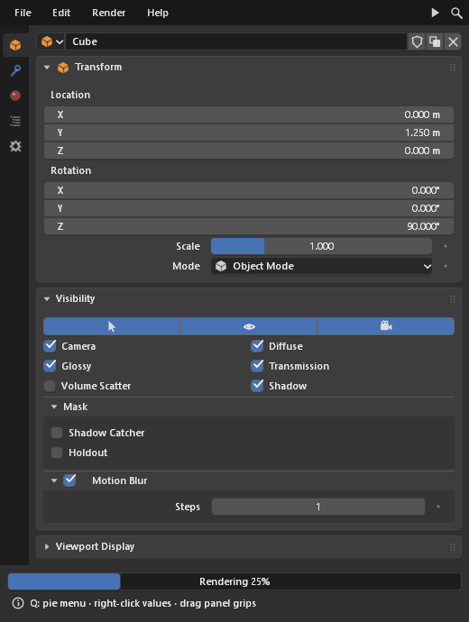

# Blender components (`bui.components`)

A component library built from Blender's interface: the widgets, layouts,
menus and editors of Blender's properties editor and outliner, with
Blender's interaction rules. Each component is a node of the C kit. Python
builds the tree and receives callbacks; everything else runs in C.



## Hello, components

```python
from bui.components import App, Panel, NumberSlider, Checkbox, Button

def on_size(value):
    print("size is now", value)

App("Demo", (360, 260),
    Panel("Object",
          NumberSlider("Size", 1.0, min=0, max=10, on_change=on_size,
                       description="Object size"),       # tooltip
          Checkbox("Smooth", True),
          Button("Apply", on_click=lambda: print("apply"))),
).run()
```

## App

```text
App(title="BUI", size=(420, 640), *children, padding=None, spacing=None, header=None)
```

| Member | |
|---|---|
| `app.root` | The root `Column`, holding `children` |
| `app.add(*components)` | Append to the root |
| `app.bind("ctrl+s", fn)` | Window hotkey (`"q"`, `"shift+f3"`, `"ctrl+alt+z"` ...) |
| `app.run(native=None)` | Open the window and run the loop. `native=False` forces the Tk host. |
| `app.open(native=None)` | Open the window without running the loop. Returns the `bui.host.Window`. |
| `app.ctx` | The C kit context (popups, focus, undo: `ctx.undo()` / `ctx.redo()`) |
| `app.render_raster(w, h)` | Render headlessly into a `buipy.Raster` (tests, screenshots) |
| `app.press / release / motion / key / wheel / context_menu` | Drive input headlessly (tests) |

Pass a `MenuBar` as `header=` for a Blender top bar.

## GPU rendering

Call `bui.set_gpu(True)` before creating windows, or run with `BUI_GPU=1`, to
draw them on the GPU (Direct3D 11 on Windows, OpenGL on Linux). The pixels are the same and the CPU cost
is much lower. See [getting-started.md](getting-started.md#gpu-rendering).

## Common component API

Every component has:

| Member | |
|---|---|
| `description=` | Tooltip text, shown after hovering |
| `enabled` / `visible` | Properties, also constructor keywords |
| `weight=` | Share of the width in a `Row` (`0` keeps the natural width) |
| `x, y, w, h`, `rect` | Geometry after layout |
| `add(*children)`, `remove(c)`, `children` | Tree editing (containers) |

Value components (`NumberField`, `NumberSlider`, `Checkbox`, `Toggle`,
`TextField`, `Dropdown`, `EnumRow`, `ColorSwatch` ...) also have:

| Member | |
|---|---|
| `value` | Current value (assigning it notifies `on_change`) |
| `set_value(v, notify=True)` | Set, optionally without the callback |
| `reset()` | Back to the default (also Backspace over the widget) |
| `on_change=` | `fn(value)`, called when the user or code changes it |

## Layout

| Component | Signature | Notes |
|---|---|---|
| `Column` | `Column(*children, align=False, spacing=None, padding=0)` | Vertical stack. `align=True` joins widgets like Blender's `column(align=True)`. |
| `Row` | `Row(*children, align=False, spacing=None, padding=0)` | Horizontal. Each child's `weight` is its share of the width. |
| `Split` | `Split(left, right, factor=0.4)` | Label / value split used by property rows |
| `Grid` | `Grid(*children, columns=2)` | |
| `Box` | `Box(*children, align=False, ...)` | Blender's `layout.box()` |
| `Panel` | `Panel(title, *children, collapsed=False, icon=None, header=(), on_toggle=None)` | Collapsible, with sub-panels, a header checkbox (`header=[Checkbox("", True)]`), drag-to-reorder grips, Ctrl+click to solo and an animated collapse |
| `Tabs` | `Tabs([("Title", component), ...], current=0, on_change=None)` | |
| `SideTabs` | `SideTabs([("ICON", "Title", component), ...])` | The properties editor's icon tabs |
| `ScrollView` | `ScrollView(child, height=None, rows=8)` | |
| `VectorField` | `VectorField(label, (x, y, z), axes="XYZW", **number_kw)` | Aligned number fields; Alt edits all of them |

## Values

| Component | Signature |
|---|---|
| `NumberField` | `NumberField(label, value, *, min=None, max=None, step=None, precision=None, integer=None, suffix="")` |
| `NumberSlider` | `NumberSlider(label, value, *, min=0, max=1)` |
| `TextField` | `TextField(label, value, *, placeholder="", icon=None, live=False)` |
| `SearchField` | `SearchField(value="", *, placeholder="Search")` |
| `HotkeyField` | `HotkeyField(label, value)`: click, then press a key combination |
| `Checkbox` | `Checkbox(label, value=False)` |
| `Toggle` | `Toggle(label, value=False, *, icon=None, icon_on=None, emboss=True)` |
| `Decorator` | `Decorator(label, value)`: the keyframe dot next to a property |
| `Dropdown` | `Dropdown(label, items, value=None, *, icons=None, icon_only=False)` |
| `EnumRow` | `EnumRow(label, items, value=None, *, icons=None, vertical=False, icon_only=False)` |
| `ColorSwatch` | `ColorSwatch(label, (r, g, b, a), *, picker="circle" or "square", alpha=True)` |

Items are strings. Give them icons with `icons=[...]`, one icon name per
item (`""` for none), or a dict from item to icon name:
`EnumRow("Mode", ["Object", "Edit"], icons=["OBJECT_DATAMODE", "EDITMODE_HLT"])`.
`ListView` takes `icons=[...]` the same way. Icon names are Blender's: all 781
of Blender's SVG icons (`buipy.kit_icon_names()` lists them).

## Buttons, labels, feedback

| Component | Signature |
|---|---|
| `Button` | `Button(text, on_click=None, *, icon=None, emboss=True)` |
| `IconButton` | `IconButton("ICON", on_click=None, *, emboss=False)` |
| `Popover` | `Popover(text, *children, icon=None)`: a button that opens a panel |
| `MenuButton` | `MenuButton(text, items, *, icon=None)` |
| `Label` | `Label(text, *, icon=None, align="left", color=None, bold=False)` |
| `ProgressBar` | `ProgressBar(value=0.0, text=None)` |
| `Separator`, `Spacer` | `Separator(factor=0.5, line=False)` / `Spacer()` |

## Views

```python
from bui.components import ListView, TreeView, TreeItem, GridView

ListView(["Cube", "Light", "Camera"], rows=5, on_rename=lambda i, s: print(i, s))

TreeView([TreeItem("Collection",
                   TreeItem("Cube", icon="MESH_DATA"),
                   TreeItem("Light", icon="LIGHT"),
                   icon="OUTLINER_COLLECTION")],
         columns=["hide", "render"],                       # outliner toggle columns
         on_toggle=lambda item, col, on: print(item.label, col, on))

GridView([("Metal", (0.7, 0.72, 0.75, 1)), ("Gold", (0.95, 0.75, 0.3, 1))],  # preview tiles
         tile=4, on_activate=print)
```

Double-click or F2 renames. Arrow keys navigate, Left and Right collapse
and expand, and you can drag down a toggle column to set it on several rows.

## Menus

```python
from bui.components import App, IconButton, MenuBar, MenuItem, PieMenu

def new_file(): print("new")
def quit_app(): print("quit")
def search(): print("search")

menubar = MenuBar(
    ("File", [MenuItem("New", new_file, icon="FILE", shortcut="Ctrl N"),
              MenuItem("Open Recent", submenu=[MenuItem("a.blend"), MenuItem("b.blend")]),
              "-",                                           # separator
              MenuItem("Auto Save", checked=True),
              MenuItem("Quit", quit_app, shortcut="Ctrl Q")]),
    right=[IconButton("SEARCH", search)])
app = App("Tool", (480, 600), header=menubar)

app.bind("q", lambda: PieMenu.show(app.ctx, [MenuItem("Object Mode"),
                                             MenuItem("Edit Mode")], "Mode"))
app.run()
```

Menus behave as in Blender. Press-drag-release picks an item. Hovering
switches between menu-bar menus and opens submenus. Typing searches every
item. Right-clicking a value opens its context menu (Copy, Paste, Reset).

## Color and editors

| Component | Signature |
|---|---|
| `ColorSwatch` | Click to open the picker: an HSV wheel and value strip, or an SV square and hue strip, plus RGB / HSV / HSL sliders, a hex field and the eyedropper |
| `ColorRamp` | `ColorRamp(stops=((0.0, rgba), (1.0, rgba)), *, interpolation="Linear", on_change=None)` |
| `CurveMapping` | `CurveMapping(points=((0, 0), (1, 1)), *, channels=(), height=8.0, on_change=None)` |
| `NormalBall` | `NormalBall(label, (x, y, z), *, size=4.0)` |
| `Histogram` | `Histogram(bins, *, height=5.0)` |
| `IDSelector` | `IDSelector(items, value, *, icon="MESH_DATA", fake_user=False, on_change, on_new, on_unlink)`: Blender's `template_ID` |
| `PathField` | `PathField(label, value, *, directory=False, on_browse=None, on_change=None)` |

## Node editor and areas

```python
from bui.components import Area, MenuButton, Node, NodeEditor, Spacer

value = Node("Value", outputs=[("Value", "float")], location=(-200, 0), kind="input")
math = Node("Math", inputs=[("A", "float", 0.5), ("B", "float", 0.5)],
            outputs=[("Result", "float")], location=(0, 0), kind="converter")
editor = NodeEditor([value, math], links=[(value, 0, math, 0)],
                    on_links=lambda links: print(links))
area = Area("Geometry Node Editor", editor,
            header=[MenuButton("View", ["Frame All"]), Spacer()],
            on_editor=print)
```

- **`Node`**:
  - `inputs` are `(name, type)` or `(name, type, value)`; a value draws a field while the input is unlinked.
  - `outputs` are `(name, type)`, and types color the sockets.
  - `kind` picks the header color (`input`, `output`, `shader`, `texture`, `color`, `vector`, `converter`, `geometry`, `group` …), or pass `color=`.
  - `on_change(node, what, value)` reports `location`, `select`, `value` and `collapsed`.
- **`NodeEditor`**:
  - `links` are `(from_node, output, to_node, input)`.
  - `on_links(links)` runs after the user links, relinks or cuts.
  - `on_delete(nodes)` runs on X / Delete; without it, the editor removes the selected nodes itself.
- **Editing, as in Blender:**
  - click selects (Shift toggles); dragging moves the selection (Ctrl snaps);
  - dragging on empty space box-selects;
  - dragging from a socket links; dragging a linked input picks its link up;
  - Ctrl+RMB drag cuts links.
- **View:** MMB pans, Ctrl+MMB and the wheel zoom, Ctrl/Shift+wheel pan, and Home frames everything.
- **`Area`**: a 1.3-unit header with the editor-type menu, then the editor filling the rest. A `Spacer()` in `header` pushes the items after it to the right.

## Interactions

All of these come from Blender and run in C, in every API (components,
tkinter and Qt).

- **Number fields.** The cursor turns into ↔ arrows over them. Dragging
  hides the cursor and grabs it continuously, so it never hits the window
  edge, and the cursor comes back where the drag started. Each pixel moves
  the value one click step, as in Blender.
  - **Shift** drags at a tenth of that speed.
  - **Ctrl** snaps by Blender's rules (whole units, 10° for angles, multiples
    of 10 for integers); **Ctrl+Shift** snaps finer.
  - **Alt** edits all linked fields (X/Y/Z) together.
  - **Escape** cancels the drag.

  Click, or Ctrl+click, to type a value. Expressions such as `2*pi`, `90/4`
  or `1e3` work (`buipy.kit_eval_number`).
- **Sliders.** The value follows the pointer across the slider from where
  the drag began. Shift moves at 1/20 the speed. When the drag ends, the
  pointer comes back at the value's position.
- **Any value.** Ctrl+Wheel steps it, Ctrl+C / Ctrl+V copy and paste it,
  Ctrl+Alt+C / V copy a whole vector, Backspace resets, Minus negates, and
  right-click opens Copy / Paste / Reset.
- **Several fields at once.** Press a number field and drag down over the
  others to collect them, then sideways to change them all.
- **Toggles and panels.** Drag across checkboxes or panel headers to set
  them all. Ctrl+click a panel header to solo it, and drag the grip to
  reorder panels.
- **Undo.** Ctrl+Z / Ctrl+Shift+Z (or Ctrl+Y) undo and redo UI edits. A
  burst of typing is one step, and so is a multi-field drag.
- **Keyboard.** Tab and Shift+Tab move to the next or previous field while
  editing. Escape cancels.

## File dialogs

`bui.filebrowser.ask` shows Blender's File Browser in its own window and waits
for an answer:

```python
from bui import filebrowser

path = filebrowser.ask("open", title="Open Image",
                       filetypes=[("Images", "*.png *.jpg"), ("All files", "*")])
folder = filebrowser.ask("directory")
paths = filebrowser.ask("open", multiple=True)        # a list
name = filebrowser.ask("save", defaultextension=".txt")
```

`kind` is `"open"`, `"save"` or `"directory"`. Cancel returns `None`.
`tkinter.filedialog` and `QFileDialog` use the same browser.

## Headless use (tests, screenshots)

```python
from bui.components import App, NumberField

field = NumberField("Size", 1.0)
app = App("Test", (400, 300), field)
raster = app.render_raster()              # lays out and draws without a window
x, y = field.x + field.w // 2, field.y + field.h // 2
app.press(x, y)                           # simulate a drag to the right
app.motion(x + 40, y)
app.release(x + 40, y)
print(field.value)                        # > 1.0
raster = app.render_raster()              # redraws only what changed
raster.pixel(x, y)                        # -> (r, g, b)
```

`bindings/python/tests/test_components.py` uses this to test every
component and to enforce the 120 Hz frame budgets.
