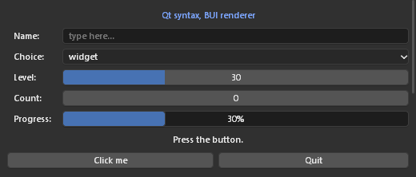

# Qt syntax on BUI

`bui.qtsyntax` lets you write Qt-style Python (`QApplication`, `QWidget`,
layouts, `clicked.connect(...)`) that runs on BUI's C kit, with Blender's
look. Neither Qt nor PySide is needed.

> **Status: partial.** The everyday subset below works and is tested.
> Measured against Qt's widget headers, about a quarter of the method names
> on the main widget classes exist. See [Coverage](#coverage) for what's
> missing and the plan.



## Example

```python
from bui.qtsyntax import (QApplication, QMainWindow, QWidget, QVBoxLayout,
                          QHBoxLayout, QFormLayout, QLabel, QLineEdit, QComboBox,
                          QSlider, QProgressBar, QPushButton, QTreeWidget,
                          QTreeWidgetItem, QMessageBox, Qt)

app = QApplication([])
win = QMainWindow()
win.setWindowTitle("Qt syntax on BUI")

central = QWidget()
layout = QVBoxLayout(central)

form = QFormLayout()
name = QLineEdit()
name.setPlaceholderText("name")
kind = QComboBox()
kind.addItems(["Mesh", "Light", "Camera"])
level = QSlider(Qt.Horizontal)
level.setRange(0, 100)
form.addRow("Name:", name)
form.addRow("Kind:", kind)
form.addRow("Level:", level)
layout.addLayout(form)

bar = QProgressBar()
level.valueChanged.connect(bar.setValue)        # signals connect to any callable
layout.addWidget(bar)

tree = QTreeWidget()
tree.setHeaderLabels(["Name", "Kind"])
layout.addWidget(tree)

buttons = QHBoxLayout()
add = QPushButton("Add")
add.clicked.connect(lambda: QTreeWidgetItem(tree, [name.text(), kind.currentText()]))
buttons.addWidget(add)
layout.addLayout(buttons)

menu = win.menuBar().addMenu("File")
menu.addAction("Quit", app.quit, "Ctrl+Q")
win.statusBar().showMessage("Ready")

win.setCentralWidget(central)
win.resize(420, 420)
win.show()
app.exec()
```

## GPU rendering

Call `bui.set_gpu(True)` before creating windows, or run with `BUI_GPU=1`, to
draw them on the GPU (Direct3D 11). The pixels are the same and the CPU cost
is much lower. See [getting-started.md](getting-started.md#gpu-rendering).

## How it maps

| Qt | On BUI |
|---|---|
| `QWidget` | A kit frame. A subclass that overrides `paintEvent` becomes a kit canvas, and `QPainter` records into its display list. |
| `QVBoxLayout` / `QHBoxLayout` | Tk's packer in C, with Qt semantics: stretch factors, expanding size policies, spacing between items only, margins on top-level layouts only |
| `QGridLayout` / `QFormLayout` | Tk's gridder in C (`setColumnStretch` maps to column weights) |
| Signals | Plain Python (`Signal` / `pyqtSignal`). Slots that take fewer arguments than the signal sends get fewer. |
| `QApplication.exec()` | `bui.host.run()`: a native window on Windows and Linux, a Tk-hosted window on macOS |
| `QTimer`, `QPropertyAnimation` | Window timers; animations step at 120 Hz with easing curves |

## Supported classes

| Area | Classes |
|---|---|
| Application | `QApplication` (`exec`, `quit`, `processEvents`), `QTimer` (`singleShot`, `start`, `stop`, `timeout`), `QPropertyAnimation`, `QEasingCurve` |
| Windows | `QWidget`, `QMainWindow` (`setCentralWidget`, `menuBar`, `statusBar`), `QDialog` (`exec`, `accept`, `reject`), `QFrame` |
| Layouts | `QVBoxLayout`, `QHBoxLayout` (`addWidget(stretch)`, `addLayout`, `addStretch`, `addSpacing`, `insertWidget`, `setSpacing`, `setContentsMargins`), `QGridLayout` (spans, alignment, stretch), `QFormLayout.addRow`, `QStackedLayout` |
| Widgets | `QLabel` (text, alignment, pixmap), `QPushButton` / `QToolButton`, `QCheckBox`, `QRadioButton` + `QButtonGroup` (auto-exclusive), `QLineEdit` (`textChanged`, `returnPressed`, `editingFinished`), `QTextEdit` / `QPlainTextEdit`, `QSlider` / `QDial`, `QSpinBox` / `QDoubleSpinBox`, `QProgressBar` (format), `QComboBox` (items, data, `currentIndexChanged`) |
| Views | `QListWidget` / `QListWidgetItem`, `QTreeWidget` / `QTreeWidgetItem` (columns, expand), `QTableWidget` / `QTableWidgetItem` |
| Containers | `QTabWidget`, `QGroupBox` (a Blender panel), `QScrollArea`, `QStatusBar` |
| Menus | `QMenuBar`, `QMenu` (`addAction(text, slot, shortcut)`, submenus, separators, `popup`), `QAction` (checkable, shortcuts) |
| Painting | `QPainter` (`fillRect`, `drawRect`, `drawRoundedRect`, `drawEllipse`, `drawLine`, `drawPolyline`, `drawPolygon`, `drawArc`, `drawPie`, `drawText`, `drawPixmap`, `translate`, `save`, `restore`, `setOpacity`), `QPen`, `QBrush`, `QColor`, `QFont`, `QPixmap` / `QImage` |
| Events | Override `mousePressEvent`, `mouseReleaseEvent`, `mouseMoveEvent`, `mouseDoubleClickEvent`, `keyPressEvent`, `wheelEvent`, `enterEvent`, `leaveEvent`, `closeEvent`, `paintEvent`. Event types: `QMouseEvent`, `QKeyEvent`, `QWheelEvent`, `QPaintEvent`, `QCloseEvent`. |
| Values | `Qt` constants (alignment, keys, orientation, check states), `QPoint`, `QSize`, `QRect`, `QMargins`, `QSizePolicy`, `QIcon` |
| Dialogs | `QMessageBox` (static calls return immediately; not drawn yet), `QFileDialog` (the OS file dialogs) |

Member-by-member tables: [../SYNTAX_COVERAGE.md](../SYNTAX_COVERAGE.md#qt-syntax-buiqtsyntax).

### Custom painting

```python
from bui.qtsyntax import QApplication, QWidget, QPainter, QColor, QPen

class Gauge(QWidget):
    def __init__(self):
        super().__init__()
        self.value = 0.6

    def paintEvent(self, event):
        p = QPainter(self)
        p.setBrush(QColor("#282828"))
        p.drawRoundedRect(0, 0, self.width(), 24, 6, 6)
        p.setBrush(QColor("#4772b3"))
        p.drawRoundedRect(0, 0, int(self.width() * self.value), 24, 6, 6)
        p.setPen(QPen(QColor("white")))
        p.drawText(8, 17, "%d%%" % (self.value * 100))
        p.end()

    def mousePressEvent(self, e):
        self.value = e.x() / max(1, self.width())
        self.update()                  # repaints the display list
```

## Coverage

There is no Qt installed in the test environment, so coverage was counted
from Qt's own widget headers (`reference/qtbase`): **about 220 of 920
public method names** across 25 core widget classes (~24%).

**Missing:**

- Model/view: `QAbstractItemModel`, `QListView`, `QTreeView`,
  `QTableView`, delegates
- `QSplitter`, `QDockWidget`, `QToolBar`, `QStackedWidget` (as a real
  class), `QToolBox`, `QDateEdit` and friends, `QCalendarWidget`
- Most of `QWidget`'s surface: focus policy details, `setWindowFlags`,
  geometry helpers, `grab`
- Stylesheets beyond `color`, `background` and `font-weight`; `QPalette`
- `QSettings`, `QThread`, `QClipboard`, drag-and-drop, `QShortcut`
- `QMessageBox` and `QInputDialog` as drawn dialogs (the tkinter layer
  already has Blender-styled dialogs that can be reused)

**Plan.** Reach parity with the tkinter layer:

1. Measure against PySide6 itself, and run the same programs on real Qt
   and on BUI to compare, as `test_tk_compat.py` does for tkinter.
2. Make widgets wrap kit nodes instead of being them (as `bui.tksyntax`
   does), which removes name clashes like `rect()` and `children()`.
3. Fill in the classes above, then add `install()` so `import PySide6`
   programs run unchanged.
