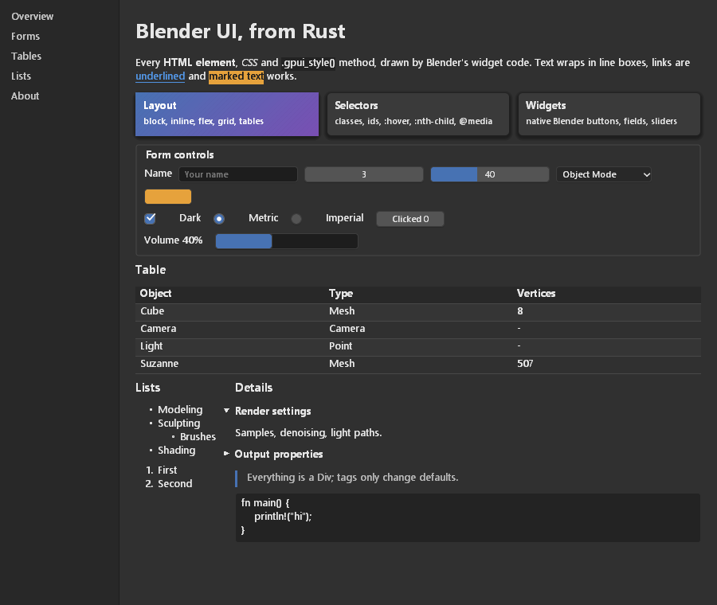

# Rust: gpui syntax, HTML and CSS

The `blenderui` crate (`bindings/rust/`) gives Rust programs Blender's UI with
the syntax of [gpui](https://www.gpui.rs): views implement `Render`, elements
are built with `div().flex().gap_2().child(...)`, and listeners come from
`cx.listener(...)`. On top of gpui's model it supports **every HTML element**
and **CSS**: `<style>` sheets, selectors, the cascade, flexbox, grid, tables,
inline text that wraps, lists, `<details>`, and form controls that are real
Blender widgets.

<p align="center"></p>

- [Install](#install)
- [The app model](#the-app-model)
- [Elements](#elements)
- [Styling](#styling)
- [Layout](#layout)
- [Form controls](#form-controls)
- [Events](#events)
- [Painting your own content](#painting-your-own-content)
- [Headless rendering and tests](#headless-rendering-and-tests)
- [Coverage](#coverage)
- [Performance vs gpui](#performance-vs-gpui)
- [Limitations](#limitations)
- [How it works](#how-it-works)

## Install

```toml
[dependencies]
blenderui = { git = "https://github.com/ppmpreetham/BUI" }
```

Building needs **CMake** and a **C compiler**: `blenderui-sys` compiles the C
kit with the `cmake` crate. On Windows the default Rust target
(`x86_64-pc-windows-msvc`) uses MSVC (Visual Studio Build Tools). To build
against another checkout of the C sources, set `BUI_SOURCE_DIR`.

From the repository:

```sh
cd bindings/rust
cargo run --example showcase                        # the window above
cargo run --example showcase -- --screenshot a.png   # render it off-screen to a PNG
cargo run --example counter                         # the README example
cargo test                                          # unit, coverage and headless tests
```

The workspace uses edition 2024 (Rust 1.85 or newer).

## The app model

It follows gpui closely:

| gpui                                     | blenderui                                                     |
| ---------------------------------------- | ------------------------------------------------------------- |
| `Application::new().run(\|cx\| ...)`      | the same; `Application::headless()` renders off-screen        |
| `cx.open_window(options, \|window, cx\| cx.new(\|cx\| View))` | the same; returns `WindowHandle<View>`   |
| `impl Render for View`                    | the same: `fn render(&mut self, window, cx) -> impl IntoElement` |
| `Entity<T>`, `WeakEntity<T>`, `cx.new`    | the same: `read`, `update`, `downgrade`, `upgrade`            |
| `Context<T>`: `notify`, `listener`, `entity` | the same; it derefs to `App`                              |
| `WindowOptions { window_bounds, titlebar, .. }`, `WindowBounds::Windowed(..)` | the same, plus `is_resizable`, `window_min_size` |
| `cx.set_global`, `cx.global`              | the same                                                       |
| `cx.stop_propagation()`                   | the same                                                       |

```rust
use blenderui::prelude::*;

struct Todo { items: Vec<String>, draft: String }

impl Render for Todo {
    fn render(&mut self, _: &mut Window, cx: &mut Context<Self>) -> impl IntoElement {
        div().p_4().flex().flex_col().gap_2()
            .child(h2().child(format!("{} items", self.items.len())))
            .child(ul().children(self.items.iter().map(|s| li().child(s.clone()))))
            .child(div().flex().gap_2()
                .child(input().id("draft").placeholder("New item").value(self.draft.clone())
                    .on_change(cx.listener(|this, e: &ChangeEvent, _, cx| {
                        this.draft = e.value.clone();
                        cx.notify();
                    })))
                .child(button().child("Add").on_click(cx.listener(|this, _, _, cx| {
                    this.items.push(std::mem::take(&mut this.draft));
                    cx.notify();
                }))))
    }
}
```

`cx.notify()` re-renders. Rendering builds a fresh element tree; elements with
an `.id(...)` keep their state across renders (scroll position, a text field's
contents, a checkbox you clicked, which `<details>` are open).

`Window` gives listeners `viewport_size()`, `scale_factor()`, `mouse_position()`,
`set_window_title()`, `focus_id()` / `focused_id()`, `is_hovered(id)`,
`scroll_offset(id)` / `set_scroll_offset(id, x, y)`, `refresh()` and
`request_animation_frame()` (call it from `render` to animate; frames are paced
to the display, `set_vsync(false)` lifts the cap).
A `<title>` element sets the window title too.

## Elements

There is **one element type, `Div`**, and a constructor for every element of
the WHATWG HTML index: `div()`, `span()`, `section()`, `table()`, `tr()`,
`details()`, `dialog()`, `input()`, `select()`, `video()` ... (113 elements,
plus `svg()` and `math()` as boxes). Tags only change the defaults: what the
user-agent stylesheet gives them and how they are realised.

| Kind      | Elements                                                                                  | Realised as                                                    |
| --------- | ----------------------------------------------------------------------------------------- | -------------------------------------------------------------- |
| Box       | `div`, `p`, `h1`-`h6`, `a`, `span`, `ul`/`ol`/`li`, `table` ..., `details`, `dialog`, `form` ... | laid out and painted from CSS                           |
| Widget    | `button`, `input`, `select`, `textarea`, `progress`, `meter` (+ `option`, `optgroup`, `datalist`) | Blender's own widgets ([below](#form-controls))        |
| Replaced  | `img`, `video`, `audio`, `iframe`, `embed`, `object`, `canvas`                            | an intrinsic size; `img` shows PNG files or RGBA pixels       |
| Metadata  | `head`, `title`, `style`, `script`, `meta`, `link`, `template` ...                        | not rendered (`<style>` and `<title>` are read)               |
| Break     | `br`, `wbr`                                                                               | line breaks                                                    |

Unknown names work too: `custom("my-widget")` is a box, like a custom element
in a browser.

Every element has `.child(..)`, `.children(..)`, `.id(..)`, `.class(..)`,
`.attr(name, value)` and typed attributes: `.href`, `.value`, `.placeholder`,
`.input_type`, `.name`, `.checked`, `.disabled`, `.selected`, `.open`, `.min`,
`.max`, `.step`, `.src`, `.alt`, `.title`, `.colspan`. `FluentBuilder` adds
`.when(cond, |el| ..)`, `.when_some(opt, |el, v| ..)` and `.map(..)`.
Text children are `&'static str`, `String` or `SharedString`.

> `main()` (the `<main>` element) has the same name as your program's
> `fn main`. Inside `fn main` call it as `blenderui::html::main()`.

The document is wrapped in `<html><body>` unless your root already is one, so
`body { margin: 0 }` and the user-agent defaults behave as in a browser. The
defaults are Blender's dark theme: `#303030` background, 13 px text, blue
links.

## Styling

Three ways, one cascade:

```rust
// 1. gpui / Tailwind methods
div().flex().items_center().gap_2().px_3().py_1().rounded_md().bg(rgb(0x3a3a3a))
    .text_color(white()).shadow_md().hover(|s| s.bg(rgb(0x4772b3)))

// 2. any CSS property
div().css("grid-template-columns", "repeat(3, 1fr)")
     .style("border-left: 3px solid #4772b3; padding: 4px 8px")

// 3. stylesheets, anywhere in the tree
style().child(".card:hover > h4 { color: #e6a23c } @media (max-width: 600px) { nav { display: none } }")
```

**`Styled` methods** (~1,300, generated from Tailwind's scales): spacing and
sizing on the spacing scale (`p_4`, `mx_auto`, `w_64`, `h_full`, `w_1_3`,
`size(px(20.0))`, `gap_x_2`), display and position (`flex`, `grid`, `block`,
`hidden`, `absolute`, `inset_0`, `z_index`), flexbox (`flex_col`, `flex_1`,
`items_center`, `justify_between`, `flex_wrap`), grid (`grid_cols(3)`,
`col_span(2)`), color (`bg`, `text_color`, `border_color`, `opacity`),
borders and corners (`border_1`, `border_t_2`, `rounded_lg`, `rounded_full`),
shadows (`shadow_sm` ... `shadow_2xl`), text (`text_sm` ... `text_6xl`,
`font_bold`, `italic`, `underline`, `uppercase`, `truncate`, `leading_tight`,
`whitespace_nowrap`), overflow (`overflow_y_scroll`) and cursors
(`cursor_pointer`). Colors: `rgb(0xRRGGBB)`, `rgba(0xRRGGBBAA)`,
`hsla(h, s, l, a)`, named helpers, or any CSS color string.

**State styles**: `.hover(|s| ..)`, `.active(|s| ..)` and `.focus(|s| ..)`
take a refinement with the same methods (they are CSS `:hover` / `:active` /
`:focus` rules for that element).

**Selectors**: type, `*`, `#id`, `.class`, attributes (`[a]`, `=`, `~=`,
`|=`, `^=`, `$=`, `*=`), combinators (descendant, `>`, `+`, `~`), and
pseudo-classes: `:hover`, `:active`, `:focus`, `:focus-within`,
`:focus-visible`, `:checked`, `:disabled`, `:enabled`, `:link`, `:any-link`,
`:required`, `:optional`, `:read-only`, `:read-write`, `:open`,
`:placeholder-shown`, `:first-child`, `:last-child`, `:only-child`,
`:first-of-type`, `:last-of-type`, `:nth-child()`, `:nth-last-child()`,
`:nth-of-type()`, `:nth-last-of-type()`, `:empty`, `:root`, `:not()`,
`:is()`, `:where()`. `@media` with width and height conditions is evaluated against the
window.

**Cascade**: user-agent sheet, then author sheets, then inline declarations
(methods, `.css`, `.style`), then state refinements; `!important` wins over
all of them, and specificity and order decide within a level. `inherit`,
`initial`, `unset` and `revert` are understood (they copy or reset the text,
color, size and display properties). Custom properties (`--name`) are
accepted but `var()` is not substituted. Units: `px`, `em`, `rem`, `%`, `vw`,
`vh`, `vmin`, `vmax`, `ch`, `ex`, `pt`, `pc`, `in`, `cm`, `mm`, `Q`, and
`calc()`, `min()`, `max()`, `clamp()`.

## Layout

Layout is computed with [taffy](https://github.com/DioxusLabs/taffy):

- **Block** flow with margins, padding, borders, `box-sizing`, min/max sizes
  and `aspect-ratio`.
- **Inline** content becomes line boxes: text breaks into words that wrap,
  inline elements (`b`, `a`, `code`, `mark` ...) style their words, and
  inline-blocks and widgets sit on the line. `white-space` (`normal`,
  `nowrap`, `pre`, `pre-wrap`, `pre-line`), `text-align`, `text-indent`,
  `letter-spacing`, `word-spacing`, `vertical-align: sub | super`,
  `text-transform` and `text-overflow: ellipsis` apply.
- **Flexbox** and **grid**: every property of both modules (except
  `grid-template-areas`), including `repeat()`, `minmax()`, `fr`,
  `auto-fill` / `auto-fit`, spans and line placement.
- **Tables**: rows and cells share the width (`colspan` weights cells),
  `border-spacing`, `border-collapse` and `caption-side` apply.
- **Positioning**: `relative`, `absolute` (and `fixed` as absolute), `inset`
  properties, `z-index` for painting and hit testing, `transform: translate()`.
- **Overflow**: `hidden` / `clip` clip, `scroll` / `auto` scroll with the
  wheel (Shift for horizontal) and show overlay scrollbars.
- **Lists**: `list-style-type` (`disc`, `circle`, `square`, `decimal`,
  `lower-alpha`, `upper-roman` ...), `list-style-position`, `<ol start>`.
- **`<details>` / `<summary>`**: clicking the summary toggles the details
  (`.open(true)` sets the initial state); `<dialog>` shows with `.open(true)`.

## Form controls

Form elements are Blender's widgets, with Blender's interaction (drag to
scrub numbers, Ctrl+Z, double-click to type, Escape to cancel):

| HTML                                              | Blender widget                       | `ChangeEvent`                         |
| ------------------------------------------------- | ------------------------------------ | ------------------------------------- |
| `button()` with text, `input().input_type("submit" \| "button" \| "reset")` | button          | `on_click`                            |
| `input()`: `text`, `password` (masked), `email`, `search`, `url`, `tel`, `date` ... | text field  | `value`                               |
| `input().input_type("number")`                    | number field                          | `number`, `value`                     |
| `input().input_type("range")`                     | slider                                | `number`, `value`                     |
| `input().input_type("checkbox")`                  | checkbox                              | `checked`                             |
| `input().input_type("radio")` (grouped by `name`) | radio button                          | `checked`                             |
| `input().input_type("color")`                     | color swatch (opens Blender's picker) | `value` as `#rrggbb`                  |
| `select()` with `option()` / `optgroup()`         | dropdown menu                         | `number` (index), `value` (text)      |
| `textarea()`                                      | multi-line text editor                | `value`                               |
| `progress()`, `meter()`                           | progress bar                          | (display only)                        |

`on_input` and `on_change` both fire when the value changes. Values you pass
(`.value(..)`, `.checked(..)`) are pushed to the widget only when they change
between renders, so a field the user is typing in is not reset; bind it to your
state (as in the todo example) to control it. A `button()` holding elements
other than text is laid out as an ordinary box (style it with CSS) and still
gets `on_click`.

## Events

| Listener                                   | Event                                                   | Bubbles |
| ------------------------------------------ | ------------------------------------------------------- | ------- |
| `on_click`                                 | `ClickEvent { down, up }` (press and release on the element) | yes |
| `on_mouse_down(button, ..)`, `on_any_mouse_down` | `MouseDownEvent { button, position, modifiers, click_count }` | yes |
| `on_mouse_up(button, ..)`                  | `MouseUpEvent`                                          | yes     |
| `on_mouse_move`                            | `MouseMoveEvent { position, pressed_button, modifiers }` | yes    |
| `on_hover`                                 | `bool`: entered / left                                  | no      |
| `on_scroll_wheel`                          | `ScrollWheelEvent { position, delta, modifiers }`       | yes     |
| `on_key_down`, `on_key_up`                 | `KeyDownEvent { keystroke: Keystroke { key, key_char, modifiers } }` | yes (from the focused element) |
| `on_change`, `on_input`                    | `ChangeEvent { value, checked, number }`                | yes     |

Positions are logical pixels. Clicking an element focuses it; key events go
to the focused element and bubble up. `cx.stop_propagation()` stops bubbling.

## Painting your own content

`canvas(|bounds, painter| ..)` is gpui's `canvas()`: it paints with a
`Painter` in logical pixels, clipped to its box.

```rust
canvas(|b, p| {
    p.fill(b, rgb(0x232323));
    p.quad(b, 6.0, rgba(0x4772b380), rgb(0x4772b3), 1.0);       // rounded rect + border
    p.line(&[(b.origin.x, b.origin.y), (b.origin.x + 80.0, b.origin.y + 40.0)], white(), 2.0);
    p.oval(Bounds { origin: point(10.0, 10.0), size: size(20.0, 20.0) }, red(), black(), 1.0);
    p.text(b.origin.x + 4.0, b.origin.y + 4.0, "hello", 13.0, white());
})
.w(px(200.0)).h(px(100.0))
```

`Painter` also has `polygon`, `arc` (pie slices), `image` (scaled) and
`with_clip`. Images: `img().src("file.png")` (PNG, decoded once and cached) or
`img().image_rgba(w, h, pixels)`.

## Headless rendering and tests

`Application::headless()` runs the same code without a native window (and is
what you get on platforms without one). Drive it from the `run` closure:

```rust
Application::headless().run(|cx| {
    let win = cx.open_window(WindowOptions::default(), |_, cx| cx.new(|_| Counter { count: 0 }))
        .unwrap();
    let b = cx.element_bounds(win.id, "plus").unwrap();         // the element with .id("plus")
    cx.simulate_click(win.id, b.origin.x + 2.0, b.origin.y + 2.0);
    assert_eq!(win.root().read(cx).count, 1);
    let (w, h, pixels) = cx.draw(win.id);                       // 0x00RRGGBB, device pixels
});
```

Also `simulate_mouse_move`, `simulate_scroll` and `simulate_key(text, keysym)`.
The kit has global state, so one `Application` runs at a time per process
(`run` takes a lock; parallel tests queue up).

## Coverage

From `cargo test --test parity -- --nocapture`:

| Area                                  | Coverage                                                                         |
| ------------------------------------- | -------------------------------------------------------------------------------- |
| HTML elements (WHATWG index)          | **113 / 113** constructible, plus `svg` / `math` roots; 9 are Blender widgets     |
| CSS properties                        | **173** change layout or rendering; **87** more parse but have no effect          |
| CSS 2.1, screen properties            | **76 / 90** rendered, 90 / 90 parsed                                              |
| Flexbox                               | **12 / 12**                                                                       |
| Grid                                  | **22 / 23** (no `grid-template-areas`)                                            |
| gpui / Tailwind `Styled` methods      | ~1,300                                                                            |

The CSS 2.1 properties that parse without effect: `float`, `clear`, `clip`,
`content`, `counter-increment`, `counter-reset`, `direction`,
`unicode-bidi`, `empty-cells`, `table-layout`, `list-style-image` and
`background-attachment` / `-position` / `-repeat` (there are no background
images; gradients are supported).

## Performance vs gpui

The same UI on blenderui, [gpui-fast](https://github.com/longbridge/gpui-fast)
0.1.13 and gpui 0.2.2: a window of N rounded, labelled cells that all change
every frame. Ryzen 7 5800U laptop at 60 Hz, one session, median of 3 runs.
[bindings/rust/bench](../bindings/rust/bench/README.md) has the full table and
how to re-run it.

| | blenderui | gpui-fast | gpui |
|---|---|---|---|
| 100 / 1000 animated cells | 60 / 60 fps (display cap; 500 / 97 uncapped) | 60 / 60 fps | 60 / 60 fps |
| 3000 animated cells | **32.6 fps** | 29.7 fps | 22.8 fps |
| CPU per frame at 3000 cells | 39.7 ms (all threads) | **18.4 ms** + GPU | 44.1 ms + GPU |
| RAM (working set) | **20-36 MB** | 34-65 MB + 19-24 MB GPU | 33-78 MB + 16-21 MB GPU |
| First frame after launch | **~6 ms** | ~205 ms | ~220 ms |

blenderui leads on frame rate in the heavy scene, memory and startup.
gpui-fast does the least CPU work per frame. blenderui rasterises on the CPU
in parallel bands (`BUI_RASTER_THREADS=1` forces one thread). `BUI_PROFILE=1`
prints its per-phase frame times.

## Limitations

- **No floats** (`float` is ignored), no `::before` / `::after` or generated
  content, no right-to-left text.
- **One font face**: the UI font in regular, bold and italic. `font-family`
  is parsed but `monospace` text uses the UI font.
- **Transforms**: `translate` only; `scale()` and `rotate()` are ignored.
- **No `var()`**: custom properties are accepted but not substituted.
- **Inline boxes** paint their background per word; borders and padding on
  inline elements (`<kbd>`, `<code>`) are not drawn.
- **Widgets draw above page content**, so a `z-index`ed box (a `<dialog>`)
  over a form field does not cover the field.
- **Images**: PNG only, nearest-neighbour scaling. `video`, `audio`,
  `iframe` show a placeholder.
- **Windows** are native on Windows; elsewhere use `Application::headless()`
  until the Linux and macOS window hosts exist.
- `text-align: justify` aligns left; `<table>` columns are equal-width
  (weighted by `colspan`) rather than sized to their content.

## How it works

```
 Render::render ─► element tree (one Div type for every tag)
        │
  cascade: UA sheet ▸ <style> sheets ▸ inline ▸ :hover/:active/:focus ▸ !important
        │          one handler table applies every property
  box tree: blocks, line boxes of words, flex/grid items, tables as flex
        │
  taffy layout ─► absolute boxes, clips, scroll offsets
        │
  paint ─► one display list on a kit canvas      form controls ─► kit widget nodes,
        │  (rects, rounded rects, text, images)                 placed at their boxes
        ▼
  C kit: input, hit testing, Blender widget drawing, damage rendering, Win32 window
```

- `blenderui-sys` is the raw FFI over `kit/include/BUI_kit.h`; its build script
  builds the C kit with CMake and links it statically.
- Every style source (methods, `.css`, `.style`, sheets, the user-agent sheet,
  state refinements) becomes CSS declarations applied by one table of property
  handlers, so a property has exactly one implementation.
- Each render rebuilds the display list and reconciles widget nodes by key,
  re-rendering after events (on the next turn of the native message loop).
