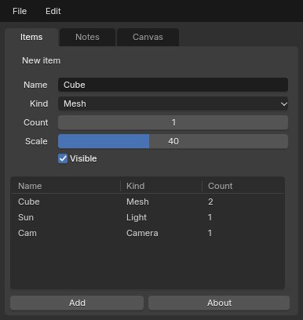

# tkinter on BUI

`bui.tksyntax` is a complete implementation of the `tkinter` API on BUI's C
kit. Programs keep their tkinter code and get Blender's look and interactions.



## Three ways to use it

**1. Run an existing program unchanged**

```sh
python -m bui.tksyntax my_app.py [args...]
```

This runs the script with `tkinter` (and `tkinter.ttk`, `tkinter.messagebox`
...) pointing to BUI. `sys.argv` is passed through, so the script sees its
own arguments.

**2. Switch inside your program**

```python
import bui.tksyntax
bui.tksyntax.install()   # before the first `import tkinter`

import tkinter as tk
from tkinter import ttk
```

`install()` covers `tkinter` and its submodules: `ttk`, `messagebox`,
`filedialog`, `simpledialog`, `colorchooser`, `commondialog`, `dialog`,
`font`, `scrolledtext` and `constants`.

**3. Import it by name**

```python
import bui.tksyntax as tk
from bui.tksyntax import ttk, messagebox, filedialog
```

## Example

```python
import tkinter as tk
from tkinter import ttk, messagebox

root = tk.Tk()
root.title("Inventory")

# menus become a Blender menu bar
menubar = tk.Menu(root)
filemenu = tk.Menu(menubar, tearoff=0)
filemenu.add_command(label="Quit", accelerator="Ctrl+Q", command=root.destroy)
menubar.add_cascade(label="File", menu=filemenu)
root.config(menu=menubar)

form = ttk.LabelFrame(root, text="New item")            # a Blender panel
form.pack(fill="x", padx=6, pady=6)
name = tk.StringVar(value="Cube")
ttk.Label(form, text="Name").grid(row=0, column=0, sticky="e", padx=4)
ttk.Entry(form, textvariable=name).grid(row=0, column=1, sticky="we")
ttk.Label(form, text="Count").grid(row=1, column=0, sticky="e", padx=4)
tk.Spinbox(form, from_=1, to=99).grid(row=1, column=1, sticky="we")  # a number field
form.columnconfigure(1, weight=1)

tree = ttk.Treeview(root, columns=("name", "kind"), show="headings", height=5)
for col in ("name", "kind"):
    tree.heading(col, text=col.title())
tree.insert("", "end", values=("Cube", "Mesh"))
sb = ttk.Scrollbar(root, orient="vertical", command=tree.yview)
tree.configure(yscrollcommand=sb.set)
tree.pack(side="left", fill="both", expand=True)
sb.pack(side="right", fill="y")

ttk.Button(root, text="About",
           command=lambda: messagebox.showinfo("About", "Plain tkinter")).pack()
root.mainloop()
```

The full version is `examples/tk_unchanged_app.py`.

## GPU rendering

Pass `gpu=True` to draw the window on the GPU (Direct3D 11) instead of the
CPU:

```python
import bui.tksyntax as tk

root = tk.Tk(gpu=True)
```

The pixels are the same, but rendering uses far less CPU, which helps busy
`Canvas` scenes most. For apps you run unchanged
(`python -m bui.tksyntax app.py`), set `BUI_GPU=1` instead, or call
`bui.set_gpu(True)` before the first `Tk()` (and `bui.set_slug(False)` for
the glyph-atlas text path instead of Slug). The first frames draw on the
CPU while the device starts. If no GPU is available, the window stays on
the software raster.

## Module map

| tkinter | BUI | Notes |
|---|---|---|
| `tkinter` | `bui.tksyntax` | `Tk`, `Toplevel`, every classic widget, variables, `Event`, `PhotoImage`, `BitmapImage`, `mainloop`, constants |
| `tkinter.ttk` | `bui.tksyntax.ttk` | Themed widgets including `Treeview`, `Notebook`, `Progressbar`, `Combobox`, `Separator`, `Sizegrip`, `LabeledScale`, `Panedwindow`, `Style`. `state()` / `instate()` work. |
| `tkinter.messagebox` | `.messagebox` | Blender-styled modal dialogs with the same return values (`"ok"`, `True`, `None` ...) |
| `tkinter.simpledialog` | `.simpledialog` | `Dialog` (override `body` / `validate` / `apply`), `SimpleDialog`, `askstring`, `askinteger`, `askfloat` |
| `tkinter.filedialog` | `.filedialog` | The operating system's file dialogs, as with Tk on Windows and macOS |
| `tkinter.colorchooser` | `.colorchooser` | `askcolor` with Blender's color picker; returns `((r, g, b), "#rrggbb")` |
| `tkinter.font` | `.font` | `Font`, named fonts (`TkDefaultFont` ...), `measure` / `metrics` through the native text engine |
| `tkinter.scrolledtext` | `.scrolledtext` | `ScrolledText`, as in tkinter |
| `tkinter.dialog`, `.commondialog`, `.constants` | same names | |

## What you get

- **Geometry managers.** `pack`, `grid` and `place` with every option:
  `in_`, `before`/`after`, `ipadx`, `sticky`, spans, `columnconfigure`
  weights and `minsize`, `grid_remove`, `*_info`, `*_slaves`, `grid_bbox`,
  `grid_location`, `grid_size`, and `pack_propagate(False)`. The packer and
  gridder are C ports of Tk's own algorithms.
- **Scrolling.** `xview` / `yview` / `*_moveto` / `*_scroll` and
  `x/yscrollcommand` work on `Listbox`, `Text`, `Treeview` and `Canvas`.
  `Canvas` adds `scrollregion`, `confine`, scroll increments and `scan_*`.
  `Scrollbar` is drawn as a Blender scroller and speaks Tk's protocol, so
  `sb.config(command=lb.yview); lb.config(yscrollcommand=sb.set)` works.
  Scrollable frames (Canvas + `create_window` + `<Configure>` →
  `scrollregion=bbox("all")`) work too.
- **Bindings.** `bind`, `bind_all`, `bind_class`, `bindtags`, `unbind*`,
  `event_add` and `event_generate`:
  - modifiers (`Control`, `Shift`, `Alt`, `B1`), `Double-`, buttons 1–3,
    `<B1-Motion>`, `<KeyPress>` / `<KeyRelease>`;
  - `<MouseWheel>` (Button-4/5 on X11), `<Enter>` / `<Leave>`, `<Configure>`,
    `<Map>`, `<Destroy>`, `<FocusIn/Out>`, and virtual events;
  - callbacks run once per bindtag and stop on `"break"`;
  - `Event` carries Tk's fields.
- **Widgets.** `Entry` supports `show="*"` and `validate` /
  `validatecommand` with `%P %s %S %d %i %V %W`. `Listbox` supports
  `selectmode` single / browse / multiple / extended, with Ctrl and Shift
  clicks. `Treeview` has sortable headings (`heading(command=...)`),
  `show="headings"` tables, `<<TreeviewOpen>>` / `<<TreeviewClose>>`, and
  `move` / `detach` / `reattach`. Also included: `Notebook`, `PanedWindow`
  with draggable sashes, `OptionMenu` (a Blender enum dropdown),
  `Menubutton`, and `Message`.
- **Canvas.**
  - Items: all types, including `window`, smoothed lines and arrowheads.
  - Tags: tag expressions (`"a&&!b"`), `find_*` / `addtag_*`, and
    `tag_bind` with `current` plus per-item `<Enter>` / `<Leave>`.
  - Editing: shape-accurate hit tests, `move` / `moveto` / `scale` /
    `coords`, and editing text items in place.
- **Text.**
  - Indices: the full grammar (`3.5`, `end-1c`, `insert lineend`, `@x,y`,
    `tag.first`, marks, `+N lines`, `wordstart` ...).
  - Tags: foreground and background colors, priorities, and `tag_bind`.
  - Also: marks with gravity, `search` (regexp, backwards, `count`), `dump`,
    `count`, the undo stack, `<<Modified>>`, and peers.
- **Windows.** `geometry` (size and `+x+y`), `attributes` (`-topmost`,
  `-alpha`, `-fullscreen`, `-disabled`), `resizable`, `minsize` / `maxsize`,
  `overrideredirect`, `state` / `iconify` / `withdraw`, `transient`,
  `protocol("WM_DELETE_WINDOW")`, `grab_set` (disables the other windows),
  clipboard, `after` / `after_idle` / `after_info`, `wait_window`,
  `wait_variable` and every `winfo_*`.
- **Images.** `PhotoImage` reads PNG / PPM / PGM in pure Python and GIF
  through Tk. It supports `put` / `get` / `copy` / `zoom` / `subsample` /
  `copy_replace` / `data` and `write` (PNG, PPM). `BitmapImage` reads XBM.

## The Blender look

The look always comes from Blender's theme:

- `tk.Scale` and `ttk.Scale` are Blender sliders (drag to scrub, click to
  type).
- `Spinbox` is a Blender number field.
- `Combobox` and `OptionMenu` are Blender enum dropdowns.
- `LabelFrame` is a Blender panel.
- `Checkbutton(indicatoron=0)` is a Blender toggle button.

Some options only change Tk's appearance: `relief`, `borderwidth`,
`highlightthickness`, `activebackground`, `selectcolor`, `ttk.Style`
settings and similar. They are accepted and returned by `cget`, but they
don't change what's drawn.

These options do apply:

- `bg` on `Frame`, `Canvas` and windows
- `fg` on text
- `font` (size and bold: `font=("Arial", 18, "bold")`)
- `cursor` (`"hand2"`, `"xterm"`, `"fleur"` ...)
- `width` / `height` (characters or pixels, as in Tk)
- `image`
- `state`

On top of that, every widget gets Blender's interactions (see
[components.md](components.md#interactions)). Number fields scrub,
Ctrl+Z / Ctrl+Shift+Z undo edits, and Tab moves to the next field.

## Behaviour

BUI follows Tk's semantics, checked against the stdlib by
`tests/test_tk_compat.py`. Some of them are easy to miss:

- `textvariable` overrides `text`, and `cget("text")` returns the
  variable's value.
- A `Scale`'s `command` and `<<TreeviewSelect>>` run when the loop is idle,
  not inside `set()` / `selection_set()`.
- `validatecommand` also sees programmatic `insert` / `delete`.
- Generated key events (`event_generate("<Control-q>")`) go to the widget
  with keyboard focus.
- Menus keep Tk's tearoff entry at index 0 unless you pass `tearoff=0`.
- `Text` keeps the trailing newline: `get("1.0", "end")` ends with `"\n"`,
  so use `"end-1c"`.
- `edit_undo()` does nothing while `undo` is off.
- A `Notebook` requests the size of its largest page.
- A `Toplevel` appears when the loop is next idle, sized to its content.
- `Checkbutton` and `Radiobutton` create a variable if you don't give one,
  as Tk does.

## Limitations

- `send` raises `TclError`, as on Windows Tk.
- Images and windows embedded in a `Text` (`image_create`, `window_create`)
  are kept and listed, but not drawn.
- There's no Tcl interpreter. `root.tk.call(...)` handles a few common
  commands (`tk scaling`, `wm ...`, `set`, `info patchlevel`) and raises
  `TclError` for the rest.
- Canvas `dash` / `stipple` and `postscript` output are accepted but not
  rendered.

## Testing your app against tkinter

`tests/test_tk_compat.py` runs programs on both the stdlib and BUI and
compares what they observe:

```python
def prog_mine(tk, ttk):
    root = tk.Tk()
    lb = tk.Listbox(root)
    lb.insert("end", "a", "b")
    lb.selection_set(1)
    result = {"sel": lb.curselection()}
    root.destroy()
    return result
```

Add your function to `PROGRAMS` and run
`python bindings/python/tests/test_tk_compat.py`.
